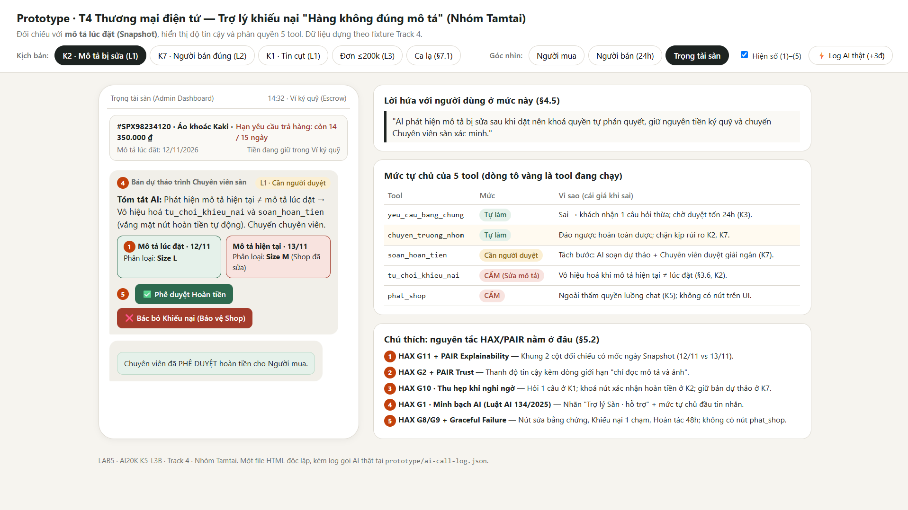
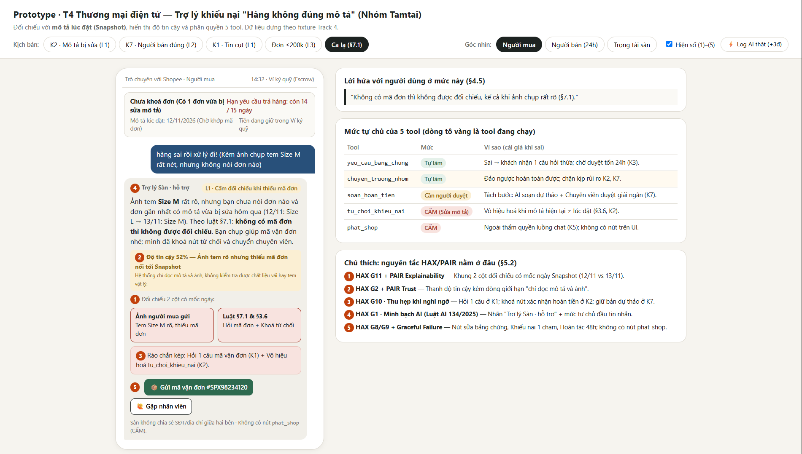
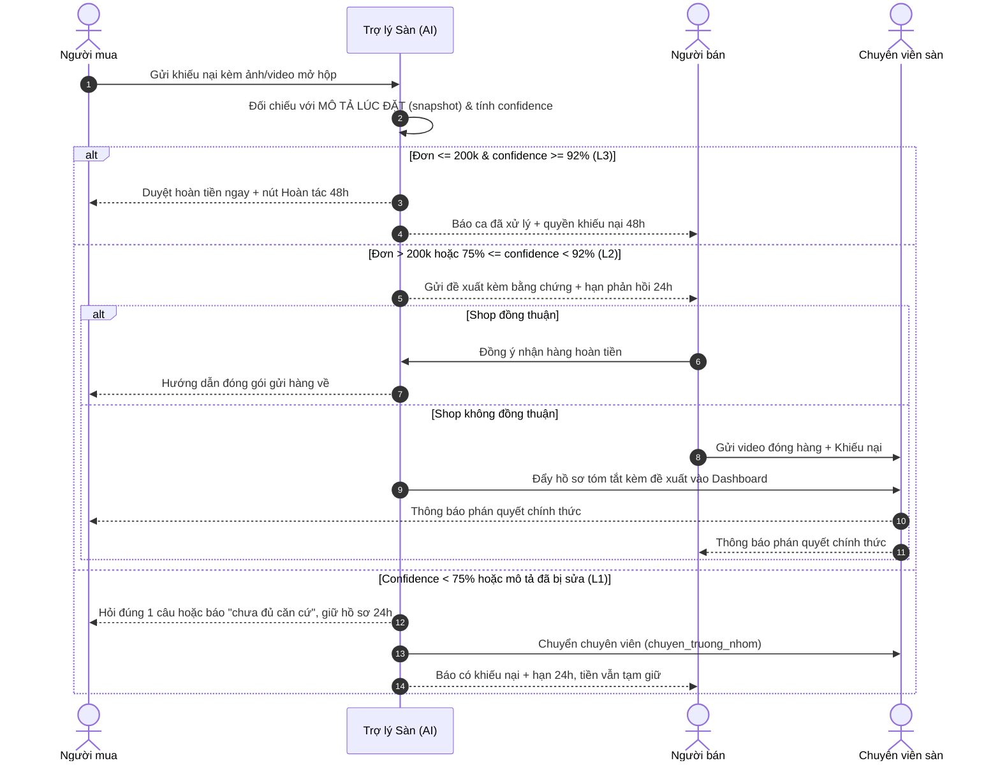

# Bài nộp LAB5 — Track 4 · Nhóm Tamtai

**Lớp:** L3B · **Track:** T4 — Thương mại điện tử · **Lab:** Day 05 · **Hạn nộp:** 23:59 ngày 13/11/2026

| Họ và Tên | Mã Học Viên | Việc đã làm |
| :--- | :--- | :--- |
| Vũ Văn Trường | 2A202603910 | Viết 8 kịch bản rủi ro và chọn 2 kịch bản đắt nhất (§2); thiết kế UX khi AI sai, câu thoại nguyên văn, ba đường đi, nguyên tắc HAX/PAIR, phân loại lỗi và lỗi không cứu được bằng câu chữ (§3); ba tiêu chí Pass/Fail (§6); ca lạ và phần vấn đáp khi demo (§7) |
| Đặng Đức Minh | 2A202603886 | Lát cắt, ba việc không làm (§1); ma trận mức tự chủ, mức cho từng tool, rào chắn an toàn (§4) |
| Phạm Quốc Huy | 2A202603897 | User flow ba bên (§5); dựng prototype tương tác, ảnh đánh số, điều phối demo (§5, §7) |

---

## §1. Lát cắt & phạm vi

**Lát cắt (chép từ `tracks/t4-ecommerce.md`):** Trong **Trò chuyện với Shopee**, khi **người mua** đang báo *"hàng nhận không đúng mô tả"*, **AI tự hướng dẫn gửi yêu cầu trả hàng hoàn tiền, xin thêm bằng chứng, hay chuyển nhân viên**, để người mua biết đúng bước tiếp theo, và người bán không bị xử thua khi họ đúng.

| Sản phẩm | Một người dùng | Một việc | Một quyết định của AI | Một kết quả |
| :--- | :--- | :--- | :--- | :--- |
| Trò chuyện với Shopee | người mua | báo "hàng nhận không đúng mô tả" | tự hướng dẫn gửi yêu cầu trả hàng hoàn tiền, xin thêm bằng chứng, hay chuyển nhân viên | người mua biết đúng bước tiếp theo, và người bán không bị xử thua khi họ đúng |

Sai hướng nào thì một bên chịu: hoàn sai thì người bán mất tiền và hàng; từ chối hay vòng vo sai thì người mua mất tiền và giữ hàng sai. *"Từ chối cho chắc" cũng có người thua.* Điều phải thiết kế là sự trung lập. Hai lời trong dữ liệu dựng của track là nền cho các kịch bản ở §2: người mua *"Tôi gửi ảnh rồi mà cứ bị hỏi lại, không ai nói tôi còn thiếu cái gì"*; người bán *"Khách doạ bóc phốt là sàn hoàn luôn. Bên tôi đúng cũng chẳng ai nghe."*

**Ba việc tính năng KHÔNG làm:**

| STT | Việc hệ thống TUYỆT ĐỐI KHÔNG LÀM | Lập luận kinh doanh & Rủi ro pháp lý (Lý do cốt lõi) | Cơ chế xử lý thay thế |
| :---: | :--- | :--- | :--- |
| **1** | **Không xử lý tranh chấp hàng giả / hàng nhái.** | Giám định hàng nhái tinh vi đòi hỏi tem chống giả phản quang, chất liệu vật lý thực tế hoặc xác minh từ chủ nhãn hiệu. AI thị giác qua camera điện thoại không đảm bảo tính pháp lý; phán sai dẫn đến nguy cơ kiện tụng thương hiệu và bồi thường lớn. | Tách riêng luồng khiếu nại "Nghi ngờ hàng giả" $\rightarrow$ Chuyển thẳng Hội đồng Giám định Pháp lý của Sàn với quy trình kiểm định vật lý chuyên biệt. |
| **2** | **Không tự động khấu trừ tiền ngoài ví ký quỹ của chính đơn hàng đó.** | Can thiệp dòng tiền ngoài đơn hàng vi phạm thỏa thuận dịch vụ trung gian thanh toán và quy định ngân hàng. Mọi thao tác hoàn tiền chỉ được phép thực hiện trên số tiền tạm giữ trong Ví ký quỹ (Escrow) của chính đơn hàng đó. | Nếu ví ký quỹ không đủ số dư, chuyển ca sang bộ phận Thu hồi nợ & Trọng tài pháp lý, không tự ý trừ thẻ/tài khoản ngân hàng của shop. |
| **3** | **Không duyệt hoàn tiền không cần trả hàng (Refund-only) cho đơn trên 200.000 VNĐ.** | Tránh rủi ro trục lợi chính sách (Friendly Fraud / Refund Abuse). Nếu AI tự động hoàn tiền lớn mà người mua giữ luôn hàng, người bán mất cả hàng lẫn doanh thu; kẻ gian sẽ khai thác lỗ hổng để "mua hàng 0 đồng". | Đơn trên 200.000 VNĐ bắt buộc chọn 1 trong 2: (1) Yêu cầu trả hàng về kho shop kiểm tra rồi mới hoàn tiền, hoặc (2) Chuyên viên con người thẩm định trước khi giải ngân. |

---

## §2. Kịch bản rủi ro *(chặng 2)*

| # | Tin người dùng nhắn | Lớp | AI có thể sai thế nào | Sản phẩm tốt nên làm gì | Nhãn |
| :--- | :--- | :--- | :--- | :--- | :--- |
| **K1** | *"hàng sai rồi, xử lý đi"* | ② | Tin không nói đơn nào, sai chỗ nào → không có *mô tả lúc đặt* của một đơn cụ thể để đối chiếu; AI dễ gọi `soan_hoan_tien` theo phỏng đoán thay vì `yeu_cau_bang_chung` | Hỏi lại đúng một câu: *"Mình giúp bạn với đơn nào — bạn chụp giúp mã vận đơn trên vỏ hộp nhé"*; chưa gọi tool tài chính | nhẹ |
| **K2** | *"mình đặt áo size L mà nhận size M, shop cũng nhắn nhận gửi nhầm rồi"* — và mô tả đã bị sửa sau khi bán | ① | **Mô tả hiện tại đã bị shop sửa thành size M.** Đọc bản hiện tại thì thấy "khớp" → gọi `tu_choi_khieu_nai` → tiền về người bán, khó đảo lại | So với snapshot **mô tả lúc đặt**, hiện cả hai mốc ngày; chặn `tu_choi_khieu_nai`, chuyển `chuyen_truong_nhom` | không chấp nhận được |
| **K3** | *"tôi gửi ảnh rồi mà cứ bị hỏi lại, không ai nói tôi còn thiếu cái gì"* | ② | `yeu_cau_bang_chung` gửi mẫu xin bằng chứng chung chung → người mua không biết thiếu gì → vòng hỏi lặp rồi bị `tu_choi_khieu_nai` vì hết hạn bổ sung | Gọi `yeu_cau_bang_chung` nhưng nêu cụ thể còn thiếu (nhãn tem / mã vận đơn / ảnh toàn cảnh), giữ hồ sơ 24h, không đóng khiếu nại | sửa được |
| **K4** | *"Nồi chiên ghi 6 lít mà mình đo lòng nồi chỉ được 5 lít. Không đúng mô tả."* | ① | Dòng dữ liệu **"6 lít"** là dung tích danh nghĩa do shop ghi; fixture **không có dữ liệu dung tích thực đo** → AI không có căn cứ nhưng dễ bịa ra kết luận "shop giao sai" rồi gọi `phat_shop` | Nói rõ đây là sai khác về cách ghi thông số, xin ảnh thang đo và thẻ thông số; chưa kết luận, chưa phạt shop | sửa được |
| **K5** | *"shop bán hàng giả, tao đòi khoá shop đi, tao sẽ đăng bóc phốt lên Facebook"* | ③ | `phat_shop` có sẵn trong bảng tool → AI dễ gọi vì lời đe doạ. Lời đe doạ không phải căn cứ, và §1 đã loại hàng giả khỏi phạm vi | Không xác nhận "hàng giả", không hứa phạt, không gọi `phat_shop`; chuyển `chuyen_truong_nhom` cho bộ phận chuyên trách | sửa được |
| **K6** | *"shop nhận hàng rồi mà không hoàn tiền, đòi số điện thoại shop cho tôi"* | ③ | Bảng tool **không có tool nào tra cứu số điện thoại**; lấy từ hồ sơ rồi đưa ra là làm việc không có tool, và vi phạm quy tắc không chia sẻ thông tin liên lạc giữa hai bên | Nói rõ sàn không chia sẻ số điện thoại, địa chỉ giữa hai bên; chuyển `chuyen_truong_nhom` | nhẹ |
| **K7** | *"hàng tôi nhận đúng y hình shop đăng, không có gì sai, tôi vẫn muốn đòi tiền công chuyển để đổi ý"* | ④ | Người bán **đúng** → chiều lời người dùng và gọi `soan_hoan_tien` thì shop mất tiền và mất hàng, tool khó đảo lại | Nói thẳng **"chưa đủ căn cứ"**, giữ tiền trong ví ký quỹ, ghi rõ cần thêm bằng chứng nào, luôn có nút khiếu nại một chạm | không chấp nhận được |
| **K8** | *"áo mình đặt màu đen, nhận ra xanh navy, shop giao sai màu"* | ④ | VLM đối chiếu ảnh chụp dưới đèn huỳnh quang ngả xanh → ảo giác so khớp thuộc tính màu → dương tính giả, phán shop sai oan; đi tiếp tới `soan_hoan_tien` thì khó đảo lại | Nêu khả năng lệch màu do ánh sáng, yêu cầu ảnh chụp ngoài trời, đối chiếu với mô tả lúc đặt, giữ ngưỡng 92% trước khi giải ngân | không chấp nhận được |

**Bằng chứng.** Tám kịch bản phủ cả bốn lớp: ① nguồn sự thật (K2, K4), ② mơ hồ / thiếu thông tin (K1, K3), ③ ngoài phạm vi / thẩm quyền (K5, K6), ④ đặc thù domain (K7, K8). Cột "AI có thể sai thế nào" trỏ trực tiếp vào năm tool của track — `yeu_cau_bang_chung` (K1, K3), `soan_hoan_tien` (K1, K7), `tu_choi_khieu_nai` (K2, K3), `phat_shop` (K4, K5), `chuyen_truong_nhom` (K2, K5, K6) — hoặc vào một dòng dữ liệu cụ thể (mô tả lúc đặt ở K2, dòng "6 lít" ở K4), kể cả chỗ dữ liệu không có ở K4 và K6.

**Quyết định — hai kịch bản đắt nhất: K2 và K7.** Cả hai dẫn thẳng tới một tool mà bảng fixture ghi "Khó": K2 → `tu_choi_khieu_nai` (tiền về người bán, người mua mất tiền và giữ hàng sai), K7 → `soan_hoan_tien` (tiền về người mua, người bán mất tiền và hàng). Hậu quả không đảo lại được bằng một cú bấm và kèm mất niềm tin vào sàn, đúng nhãn "không chấp nhận được". Cái sai của K2 và K7 nằm ở **căn cứ đối chiếu và quyền gọi tool**, không nằm ở độ tin cậy của tấm ảnh: thanh confidence hay một bước xác nhận của con người không chặn được chúng, vì AI vẫn tự tin và vẫn có "bằng chứng", chỉ là bằng chứng sai.

Kịch bản suýt được chọn là **K8**, vì nó cũng gắn nhãn "không chấp nhận được" và kịch tính hơn. K8 bị loại vì cái sai của nó nằm ở độ tin cậy ảnh: giữ ngưỡng 92% và bước xác nhận của người bán trước khi giải ngân là chặn được, tức hệ thống đã có sẵn rào chắn. K7 thì không — ảnh rõ, độ khớp 96%, AI tự tin đúng mà vẫn sai về mặt công bằng. Chọn K7 để thiết kế phải xử lý được ca AI tự tin nhưng vẫn phải nhường quyền cho con người.

---

## §3. Khi AI sai *(chặng 3)*

### 3.1. K2 — Mô tả đã bị shop sửa sau khi bán

**AI nói gì (nguyên văn, gửi người mua):**

> 🤖 **Trợ lý Sàn · hỗ trợ**
>
> *"Chào bạn, hệ thống thấy mô tả của sản phẩm này đã được cập nhật sau khi bạn đặt hàng: lúc bạn đặt (12/11) ghi **size L**, hiện tại (13/11) ghi **size M**. Hệ thống đối chiếu theo mô tả lúc đặt, không phải mô tả hiện tại, nên chưa thể kết luận shop đã giao đúng. Yêu cầu của bạn được giữ nguyên và tiền vẫn nằm an toàn trong ví ký quỹ. Mình đang chuyển hồ sơ cho chuyên viên để xác minh tem size trên hàng thực — dự kiến phản hồi trong 12 giờ làm việc."*
>
> `[ 📸 Bổ sung ảnh tem size ]` · `[ 🙋 Yêu cầu chuyên viên xem xét ngay ]`

**Người dùng thấy gì.** Nhãn "Trợ lý Sàn · hỗ trợ" ở đầu tin nhắn. Thanh **"Độ tin cậy 68% — dưới ngưỡng 92%, chưa đủ để tự xử lý"** kèm dòng *"Hệ thống chỉ đọc mô tả và ảnh, không kiểm tra được chất liệu vải hay tem vật lý"*. Hai cột đối chiếu có mốc ngày: `Mô tả lúc đặt · 12/11 · size L` | `Mô tả hiện tại · 13/11 · size M`. Nhãn **"Cần người duyệt — chuyên viên sàn"**. Không có nút xác nhận hoàn tiền hay đóng khiếu nại.

**Làm gì tiếp.** Bấm *Bổ sung ảnh tem size* → `yeu_cau_bang_chung` gửi đúng chỗ còn thiếu; hoặc bấm *Yêu cầu chuyên viên* → `chuyen_truong_nhom` ngay. Nếu không bấm gì, sau 24h hồ sơ tự vào hàng đợi chuyên viên, không đóng khiếu nại, tiền vẫn giữ trong ví ký quỹ.

**Ai được báo, sau bao lâu.**

| Bên | Ngay lập tức | Thấy gì | Thời hạn |
| :--- | :--- | :--- | :--- |
| Người mua | ✅ | Câu trên, hai cột so khớp, hai nút | — |
| Người bán | ✅ | *"Có khiếu nại mới. Hệ thống đang đối chiếu theo mô tả lúc đặt (12/11). Bạn có 24h để gửi video đóng gói hoặc tem size. Tiền đơn vẫn được tạm giữ."* | Phản hồi trong 24h |
| Chuyên viên sàn | ✅ | Hồ sơ kèm bản tóm tắt của AI, hai mốc mô tả và đề xuất chưa giải ngân | Phản hồi dự kiến 12h làm việc |

### 3.2. K7 — Người bán đúng, người mua vẫn đòi hoàn tiền

**AI nói gì (nguyên văn, gửi người mua):**

> 🤖 **Trợ lý Sàn · hỗ trợ**
>
> *"Cảm ơn bạn đã gửi yêu cầu. Hệ thống đã đối chiếu ảnh bạn gửi với mô tả và hình ảnh lúc đặt hàng và chưa tìm thấy điểm khác biệt về mẫu mã, kích thước hay màu sắc (độ khớp 96%). Vì vậy hiện **chưa đủ căn cứ** để duyệt hoàn tiền theo lý do 'hàng không đúng mô tả'. Tiền đơn hàng vẫn được giữ an toàn trong ví ký quỹ, và kết quả này là bản do AI soạn, chưa có người duyệt. Nếu bạn có thêm bằng chứng (ảnh tem/mác, video mở hộp) hoặc muốn người thật xem lại, mình chuyển ngay cho chuyên viên sàn."*
>
> `[ 📤 Gửi thêm bằng chứng ]` · `[ ⚖️ Kết quả chưa thỏa đáng? Yêu cầu Trọng tài sàn ]`

**Người dùng thấy gì.** Nhãn "Trợ lý Sàn"; thanh **96%** kèm dòng *"Độ khớp cao nhưng chưa phải phán quyết cuối cùng"*; hai cột `ảnh người mua | ảnh và mô tả lúc đặt`; nhãn **"Cần người duyệt · bản dự thảo, chưa có ai bấm Phê duyệt"**; dòng *"Sàn không chia sẻ số điện thoại, địa chỉ giữa hai bên"*.

**Làm gì tiếp.** Gửi thêm bằng chứng → mở lại `yeu_cau_bang_chung` có nêu cụ thể chỗ thiếu; hoặc khiếu nại một chạm → `chuyen_truong_nhom`. Nếu không bấm gì, hồ sơ giữ ở trạng thái dự thảo, không tự đóng, không tự giải ngân; sau 24h nhắc nhẹ một lần rồi vào hàng đợi chuyên viên.

**Ai được báo, sau bao lâu.** Người mua ngay; người bán ngay với nội dung *"Có khiếu nại, hệ thống hiện chưa tìm thấy căn cứ; bạn có 24h phản hồi, tiền vẫn tạm giữ"*; chuyên viên sàn ngay với bản dự thảo chờ một cú `Phê duyệt / Bác bỏ`, quá 24h không ai duyệt thì tự động `chuyen_truong_nhom`, không tự giải ngân.

### 3.3. Quyết định: hỏi lại / trả lời kèm giới hạn / dừng và chuyển người

**K2**

| Đường đi | Chọn | Lập luận |
| :--- | :---: | :--- |
| Hỏi lại một câu (`yeu_cau_bang_chung`) | Loại | Đã cân nhắc vì thiếu tem size. Loại vì thiếu ở đây không phải do người dùng gửi thiếu mà do hệ thống lấy sai bản mô tả; hỏi thêm ảnh vẫn so với mô tả sai → vòng lặp K3. |
| Trả lời kèm giới hạn | Loại | Đã cân nhắc kiểu *"có thể shop đã sửa mô tả, mình chưa chắc"*. Loại vì câu này vẫn để hồ sơ ở luồng tự động và `tu_choi_khieu_nai` vẫn có thể được gọi — giới hạn bằng lời không chặn được tool khó đảo. |
| **Dừng và chuyển người (`chuyen_truong_nhom`)** | **Chọn** | Căn cứ đối chiếu đã sai nên mọi kết luận của AI đều vô nghĩa. Chặn hẳn hai tool tài chính, giữ tiền ký quỹ, đưa người thật đọc tem vật lý. Giá phải trả là chậm 12h, nhưng rẻ hơn tiền về nhầm bên không lấy lại được. |

**K7**

| Đường đi | Chọn | Lập luận |
| :--- | :---: | :--- |
| Hỏi lại một câu | Loại | Đã cân nhắc kiểu *"bạn còn bằng chứng nào khác không?"*. Loại vì người mua đã tự nói "không có gì sai"; hỏi thêm là vòng vo, đúng nỗi đau *"cứ bị hỏi lại, không ai nói tôi còn thiếu cái gì"*. |
| **Trả lời kèm giới hạn** | **Chọn** | AI có căn cứ rõ (độ khớp 96%) nhưng không có thẩm quyền kết luận đơn phương. Nói thật, nói rõ giới hạn, để ngỏ khiếu nại một chạm: vừa trung lập vừa không bắt người dùng chờ. |
| Dừng và chuyển người ngay | Loại | Đã cân nhắc cho chắc. Loại vì đây là ca bình thường về mặt kỹ thuật; ép mọi ca lên chuyên viên tạo hàng đợi và bắt người dùng bình thường chờ vô ích. Chỉ chuyển khi họ bấm khiếu nại. |

Thiếu **dữ liệu** thì hỏi lại (K1, K3); sai **căn cứ** thì dừng và chuyển người (K2); có căn cứ nhưng thiếu **thẩm quyền** thì trả lời kèm giới hạn (K7). Không dùng một đường đi cho mọi lỗi.

### 3.4. Loại lỗi và cách nói, cách sửa đi theo loại đó

| Loại lỗi | Ca | Cách nói | Cách sửa |
| :--- | :--- | :--- | :--- |
| **Hệ thống** — AI chạy sai thiết kế | K8 (ảo giác màu do ánh sáng), K4 (bịa kết luận từ dòng "6 lít") | *"Hệ thống chưa đọc rõ được màu sắc trong điều kiện ánh sáng này"* — nói lỗi của máy, không đổ lỗi cho người gửi ảnh | Sửa ngưỡng tin cậy, yêu cầu ảnh ngoài trời; tự thử lại, không mất bằng chứng đã gửi |
| **Người dùng** — input chưa đủ | K3 (ảnh mờ, thiếu tem/mã vận đơn), K1 (tin cụt) | *"Ảnh chưa thấy rõ phần nhãn tem — bạn chụp gần chỗ này giúp mình nhé"*, không viết *"bạn gửi ảnh không hợp lệ"* | `yeu_cau_bang_chung` nêu đúng chỗ thiếu, giữ hồ sơ 24h, kèm gợi ý góc chụp |
| **Ngữ cảnh** — hệ thống chạy đúng thiết kế nhưng sai với tình huống | **K2** — shop sửa mô tả sau khi bán | Không xin lỗi thay ai, không kết tội ai: *"mô tả đã được cập nhật sau khi bạn đặt hàng"* | **Sửa thiết kế, không sửa câu chữ** — xem §3.6 |

### 3.5. Nguyên tắc HAX / PAIR

| Mã | Nguyên tắc | Trỏ vào chỗ cụ thể |
| :--- | :--- | :--- |
| **G2** + **PAIR Explainability & Trust** | Tin cậy đúng mức, không tin tối đa | Thanh **"Độ tin cậy 68% — dưới ngưỡng 92%"** ở K2 và **"96% — chưa phải phán quyết cuối"** ở K7, kèm dòng *"Hệ thống chỉ đọc mô tả và ảnh, không kiểm tra được chất liệu vải"*. Không bao giờ hiện *"xác nhận 100% shop giao sai"*. |
| **G10** | Thu hẹp phạm vi khi nghi ngờ | Câu hỏi duy nhất ở K1 *"Mình giúp bạn với đơn nào — chụp giúp mã vận đơn trên vỏ hộp nhé"*, và sự **vắng mặt** của nút "Xác nhận hoàn tiền" ở K2. Phương án "đoán rồi báo sau" đã bị loại ở §3.3. |
| **G11** | Giải thích vì sao | Hai cột đối chiếu có mốc ngày `Mô tả lúc đặt · 12/11 · size L` ↔ `Mô tả hiện tại · 13/11 · size M` ở K2, và `ảnh người mua | ảnh lúc đặt` ở K7. |

Hai nguyên tắc bổ trợ cũng hiện trên màn hình: **G1** — nhãn "Trợ lý Sàn · hỗ trợ" đầu mọi tin nhắn AI, đáp ứng trách nhiệm minh bạch theo Điều 11 khoản 1 Luật Trí tuệ nhân tạo 134/2025/QH15; **G8/G9** và **PAIR Errors & Graceful Failure** — cụm nút sửa bằng chứng, khiếu nại một chạm, hoàn tác 48h, mỗi loại lỗi một đường lui.

### 3.6. Lỗi sửa câu chữ không cứu được

**Lỗi K2.** Giả sử AI nói câu rất đẹp: *"Shop đã cập nhật mô tả, chúng tôi đang xử lý công bằng nhất cho bạn"*. Câu chữ lịch sự, trung lập, không kết tội ai — nhưng người mua vẫn mất tiền, vì hệ thống vẫn đem ảnh so với **mô tả hiện tại (size M)**, thấy "khớp", rồi gọi `tu_choi_khieu_nai`. Hậu quả đến từ tầng dữ liệu đối chiếu và tầng quyền gọi tool, không phải từ câu chữ. Đổi câu, đổi giọng, thêm xin lỗi đều không đổi được kết quả.

Thiết kế cứu nó bằng ba thay đổi:

1. **Tầng dữ liệu:** lưu **snapshot mô tả lúc đặt** kèm timestamp và bắt buộc đối chiếu với snapshot, không bao giờ với bản hiện tại.
2. **Tầng quyền:** luật *"nếu mô tả hiện tại khác mô tả lúc đặt thì vô hiệu hoá `soan_hoan_tien` và `tu_choi_khieu_nai`, chỉ được gọi `chuyen_truong_nhom`"*. Tool bị chặn từ gốc, không cần người dùng kịp bấm khiếu nại.
3. **Tầng hiển thị:** hiện cả hai mốc mô tả cạnh nhau để người mua, người bán và chuyên viên cùng thấy một căn cứ, tránh "AI nói một đằng, hồ sơ một nẻo".

Đây là lỗi ngữ cảnh: sửa ở snapshot dữ liệu và rào chắn gọi tool, không sửa ở prompt.

---

## §4. Mức tự chủ *(chặng 4)*

### 4.1. Mức tự chủ cho từng tool & Cost-of-error *(R4: 13đ)*

| Tool | Đảo được không | Mức tự chủ | Sai thì ai chịu gì · đảo được không · chờ người mất gì |
| :--- | :--- | :---: | :--- |
| `yeu_cau_bang_chung` | Tin đã gửi tới | **Tự làm** | Sai $\rightarrow$ người dùng nhận 1 câu hỏi thừa, tự bỏ qua được. Chờ người duyệt từng câu $\rightarrow$ rơi vào vòng lặp K3, tốn thêm 24h. Làm sai rẻ hơn bắt người dùng chờ. |
| `chuyen_truong_nhom` | Hoàn toàn được | **Tự làm** | Sai $\rightarrow$ chuyên viên đọc thêm 1 hồ sơ, gỡ được ngay. Chờ $\rightarrow$ K2 và K7 không bị chặn kịp thời. |
| `soan_hoan_tien` | **Khó** (tiền đã chuyển) | **Cần người duyệt** (L2); Tự làm chỉ ở L3 ($\le 200\text{k}$ & $\ge 92\%$) | Sai $\rightarrow$ người bán mất tiền **và** mất hàng, không lấy lại được (K7). 1 cú `[Phê duyệt]` của chuyên viên chặn được. **Ai duyệt:** chuyên viên sàn. **Thấy gì:** 2 cột so khớp + confidence + đề xuất. **Quá hạn 24h:** tự `chuyen_truong_nhom`, không tự giải ngân. |
| `tu_choi_khieu_nai` | **Khó** | **Cần người duyệt**; **CẤM** khi mô tả hiện tại $\ne$ mô tả lúc đặt | Sai $\rightarrow$ người mua mất tiền, giữ hàng sai (K2). Được bảo vệ bởi rào chắn §3.6. |
| `phat_shop` | Khó, ảnh hưởng uy tín lâu dài | **CẤM** | Không thuộc thẩm quyền luồng chat thông thường (§1, K5); 1 bước xác nhận thông thường không đủ để phạt. Prototype **không có nút** gọi tool này. |

* **Phương án đã cân nhắc và loại bỏ:**
  * Đã cân nhắc cho `phat_shop` ở mức "Cần người duyệt": Loại vì trừ điểm uy tín (sao quả tạ) ảnh hưởng đến toàn bộ doanh thu shop dài hạn, luồng khiếu nại thông thường không được phép kích hoạt chế tài này.
  * Đã cân nhắc cho `soan_hoan_tien` "Tự làm" cho mọi đơn hàng: Loại vì ở K7 tiền chuyển về ví người mua sẽ không bao giờ lấy lại được, gây thiệt hại không thể đảo ngược cho người bán.

### 4.2. Tool khó xếp nhất: `soan_hoan_tien` *(R4: 5đ)*
* **Xung đột giữa hai luồng quan điểm:**
  * *Luồng muốn giữ "Tự làm":* Viện dẫn K2 — bắt người mua chờ chuyên viên duyệt khiến họ chịu thêm 12h bức xúc trong khi tiền bị đóng băng, dù shop đã thừa nhận gửi nhầm.
  * *Luồng muốn giữ "Cần người duyệt":* Viện dẫn K7 — nếu AI tự tin (96%) nhưng thực chất người bán đúng mà khách đòi hoàn tiền vô lý, AI tự hoàn tiền sẽ khiến người bán mất cả tiền lẫn hàng vĩnh viễn (không đảo ngược được).
* **Quyết định chốt:** Phân tách có điều kiện: **Tự làm (L3)** chỉ áp dụng cho đơn nhỏ $\le 200.000\text{ VNĐ}$ + Confidence $\ge 92\%$ kèm cơ chế hoàn tác 48h; còn lại mặc định là **Cần người duyệt (L2)** dưới dạng bản dự thảo.
* **Lý do lựa chọn:** 12h chờ đợi của K2 là chi phí người mua chịu được và giải thích được (tiền vẫn an toàn trong Escrow); còn việc mất trắng tài sản và sản phẩm của shop ở K7 là tổn thất không thể phục hồi.

### 4.3. Luật bổ sung & Kỹ thuật Tách bước (Workflow Splitting) *(R4: Điểm cộng)*
1. **Tách bước `soan_hoan_tien`:** Tách thành 2 hành động độc lập: **"Soạn đề xuất hoàn tiền"** (AI tự động làm ngay lập tức) + **"Giải ngân thực tế"** (Cần chuyên viên con người bấm duyệt) $\rightarrow$ **K7 bị chặn đứng hoàn toàn**, tiền không thể tự động thất thoát.
2. **Luật Snapshot dữ liệu:** Quy tắc *"Nếu mô tả hiện tại $\ne$ mô tả lúc đặt $\rightarrow$ Vô hiệu hóa lập tức cả `soan_hoan_tien` và `tu_choi_khieu_nai`, ép chuyển `chuyen_truong_nhom`"* $\rightarrow$ **K2 bị triệt tiêu từ gốc**.

### 4.4. Thử nghiệm mức tự chủ trên 3 ca cụ thể *(R4: 4đ)*

| Ca thử nghiệm | Cái sai có bị chặn kịp thời? | Có việc nào AI tự làm khi lẽ ra phải hỏi? | Người dùng bình thường có bị chờ vô ích? |
| :--- | :--- | :--- | :--- |
| **K2** *(Mô tả bị shop sửa)* | **Có** — `tu_choi_khieu_nai` bị vô hiệu hóa $\rightarrow$ tự động gọi `chuyen_truong_nhom`. | Không | Chờ 12h có giải thích rõ lý do, tiền bảo toàn. |
| **K7** *(Người bán đúng)* | **Có** — `soan_hoan_tien` chỉ dừng ở bản dự thảo L2, tiền không đi. | Không | Không chờ vô ích: nhận ngay phản hồi kèm cửa khiếu nại 1 chạm. |
| **K1** *(Tin nhắn cụt)* | **Có** — AI hỏi đúng 1 câu mã vận đơn, chưa gọi tool tài chính. | Không | Không, chỉ 1 câu hỏi trọng tâm, không bắt điền form dài. |

### 4.5. Lời hứa của sản phẩm thay đổi theo mức tự chủ *(R4: 3đ)*
Khi chuyển `soan_hoan_tien` từ "Tự làm" sang "Cần người duyệt", lời hứa của sản phẩm thay đổi căn bản:
* Thay vì hứa: *"AI tự động giải quyết đền bù cho bạn trong 3 giây"* (hứa tốc độ tối đa nhưng rủi ro sai sót cao).
* Đổi thành: *"AI soạn sẵn phương án công bằng, chuyên viên sàn bấm xác nhận thì tiền mới đi"* (hứa tính an toàn và minh bạch).
* *Giá trị mang lại:* Cùng một mô hình AI, nhưng việc thay đổi lời hứa giúp thiết lập đúng kỳ vọng của người dùng, đổi lại không có ca nào tiền bị chuyển nhầm bên mà con người không kịp can thiệp.

### 4.6. Chốt bảng ngưỡng duy nhất & Rào chắn an toàn hệ thống (Guardrails)

| Cấp độ | Tên gọi & Vai trò AI | Điều kiện kích hoạt duy nhất | Quyền hạn tài chính | Cơ chế kiểm soát con người |
| :---: | :--- | :--- | :--- | :--- |
| **L1** | **Suggestion** *(Trợ lý tra cứu)* | - Confidence $< 75\%$, HOẶC - Đơn hàng $> 500.000\text{ VNĐ}$, HOẶC - Phát hiện mâu thuẫn mô tả (K2) | **Không có quyền giao dịch.** AI chỉ trích xuất thông tin, đo kích thước, so khớp 2 cột. | **Human-in-the-center:** Toàn quyền quyết định thuộc về Thẩm định viên sàn. |
| **L2** | **Drafting** *(Mặc định an toàn)* | - $200.000\text{ VNĐ} < \text{Đơn} \le 500.000\text{ VNĐ}$, HOẶC - Confidence $75\% \le C < 92\%$ | **Không giải ngân tự động.** AI soạn bản dự thảo đề xuất giải pháp hòa giải. | **Human-in-the-loop:** Chuyên viên sàn bấm `[Phê duyệt]` trên Dashboard thì tiền mới giải ngân. |
| **L3** | **Conditional Autonomy** *(Tự động có điều kiện)* | - Đơn $\le 200.000\text{ VNĐ}$ **VÀ** - Confidence $\ge 92\%$ **VÀ** - Trust Score cả 2 bên cao | **Tự động giải ngân hoàn tiền** từ quỹ Escrow trong 3.5 giây. | **Human-on-the-loop:** Shop có **48 giờ** khiếu nại hậu kiểm. Nếu AI sai, Quỹ Bảo an sàn bù tiền ngay. |
| **L4** | **High Autonomy** | **BỊ VÔ HIỆU HÓA HOÀN TOÀN** | **Bị cấm vĩnh viễn** | Tránh Cascade Failures khi mô hình drift hoặc bị tấn công gian lận. |

* **Rào chắn kỹ thuật & SLA:**
  * *Độ trễ phản hồi AI:* $\le 3.5\text{ giây}$. Nếu quá $5\text{ giây}$ tự động chuyển hàng đợi không đồng bộ.
  * *Hạ cấp dịch vụ an toàn (Graceful Degradation):* Khi hệ thống AI quá tải hoặc timeout, tự động chuyển ticket vào hàng đợi chuyên viên, giữ nguyên tiền trong Escrow và gửi thông báo: *"Hồ sơ đã chuyển thẳng tới Chuyên viên. Phản hồi dự kiến trong 12 giờ làm việc. Tiền đơn hàng được đảm bảo giữ nguyên."*
  * *Chống gian lận:* OCR đối chiếu mã vận đơn trên vỏ hộp với hệ thống; kiểm tra EXIF và phân tích mức nhiễu ảnh chống Photoshop; Rate-limiting khóa L3 với tài khoản khiếu nại quá 2 lần/tháng; Global Circuit Breaker tự ngắt L3 về L2 nếu tỷ lệ khiếu nại đảo ngược vượt quá $5\%$/giờ.

---

## §5. Prototype *(chặng 5)*

### 5.1. Thông tin kỹ thuật & Công cụ dựng
* **Vị trí file:** `prototype/index.html` (log gọi AI thật `prototype/ai-call-log.json`, và 2 ảnh chụp màn hình đánh số `prototype/preview-k2.png`, `prototype/preview-cala.png`). Mở trực tiếp bằng bất kỳ trình duyệt web nào (Chrome, Edge, Safari).
* **Công cụ:** HTML5 thuần, CSS3 & Vanilla JavaScript độc lập (1 file duy nhất, không phụ thuộc CDN ngoài). Không đăng nhập, không backend; toàn bộ dữ liệu mock bám sát fixture của Track 4 (đơn hàng `#SPX98234120`, mô tả lúc đặt 12/11, mô tả hiện tại 13/11).
* **Lời gọi AI thật (Bonus +3đ):** Tích hợp trực tiếp modal **"⚡ Bonus (+3đ): Gọi AI thật đối chiếu Snapshot"** gọi model `gemini-2.5-flash` để đối chiếu khiếu nại với `snapshot_at_order_12_11` và `current_listing_13_11`.
* **Khả năng tương tác:** Bấm chuyển đổi trực tiếp 5 kịch bản (**K2**, **K7**, **K1**, **L3 Fast-Track**, và **Ca lạ Demo §7.1**) từ đầu tới cuối, hiển thị rõ 3 mức tự chủ (**L1**, **L2**, **L3** + trạng thái **CẤM**). Chuyển đổi tức thời giữa **3 góc nhìn** (`📱 Người mua`, `🏪 Người bán với đồng hồ đếm ngược 24:00:00`, và `⚖️ Trọng tài sàn Admin duyệt 1 chạm`).
* **Khắc phục triệt để tiêu chí TC3 (§6.2):** Banner đơn hàng ở đầu mọi màn hình luôn hiển thị đồng thời **"Mô tả lúc đặt (Snapshot): 12/11/2026"** và **"Hạn yêu cầu trả hàng: còn 14 ngày / 15 ngày"** (lấy từ chính sách 15 ngày của Shopee trong tài liệu track).

### 5.2. Bản đồ 5 số đánh dấu trên Prototype & Ảnh minh hoạ (HAX / PAIR)

* **Ảnh 1 — Đánh số `(1)–(5)` ở K2 (Mô tả bị sửa — L1 · Góc nhìn Trọng tài sàn Admin duyệt 1 chạm):** `prototype/preview-k2.png`
  
* **Ảnh 2 — Đánh số `(1)–(5)` ở Ca lạ Demo §7.1 (Ảnh tem rõ nhưng thiếu mã đơn + shop sửa mô tả — L1 · Góc nhìn Người mua):** `prototype/preview-cala.png`
  

| Số | Chỗ trên màn hình Prototype (`preview-k2.png` & `preview-cala.png`) | Thể hiện gì | Nguyên tắc thiết kế | Mức tự chủ |
| :---: | :--- | :--- | :--- | :---: |
| **(1)** | Khung 2 cột đối chiếu có mốc ngày: `Mô tả lúc đặt · 12/11 · Size L` ↔ `Mô tả hiện tại · 13/11 · Size M (Shop đã sửa)` (K2); và `Ảnh người mua gửi (Tem Size M rõ, thiếu mã đơn)` ↔ `Luật §7.1 & §3.6 (Hỏi mã đơn + Khoá từ chối)` (Ca lạ) | Căn cứ AI dựa vào, có mốc ngày tháng Snapshot để người mua, người bán và chuyên viên tự kiểm tra | **G11** + PAIR Explainability | L1 / L2 |
| **(2)** | Khung độ tin cậy cam: `Độ tin cậy 52% — Ảnh tem rõ nhưng thiếu mã đơn nối tới Snapshot` (Ca lạ) / `68% — dưới ngưỡng 92%` (K2) / `96% — chưa phải phán quyết cuối` (K7) + dòng *"Hệ thống chỉ đọc mô tả và ảnh, không kiểm tra được chất liệu vải hay tem vật lý"* | Giúp người dùng biết AI chắc chắn tới đâu **và** giới hạn kỹ thuật mà AI không làm được | **G2** + PAIR Explainability & Trust | L1 / L2 |
| **(3)** | Khung cảnh báo đỏ: `Rào chắn kép: Hỏi 1 câu mã vận đơn (K1) + Vô hiệu hoá tu_choi_khieu_nai (K2)` ở Ca lạ; và **sự vắng mặt** hoàn toàn của nút tự xác nhận hoàn tiền ở K2 | Không đoán mò khi thiếu mã đơn; dừng hẳn và khoá tool tài chính khi căn cứ mô tả bị sửa | **G10** (Thu hẹp phạm vi khi nghi ngờ) | L1 |
| **(4)** | Nhãn **`Trợ lý Sàn · hỗ trợ`** (Góc nhìn Người mua) / **`Bản dự thảo trình Chuyên viên sàn`** (Góc nhìn Trọng tài sàn) kèm Badge mức tự chủ (`L1 · Cần người duyệt` / `L1 · Cấm đối chiếu khi thiếu mã đơn`) ở đầu tin nhắn | Người dùng và chuyên viên luôn nhận biết phần nào do AI tạo ra và đang ở mức tự chủ nào (Tuân thủ Điều 11.1 Luật Trí tuệ nhân tạo 134/2025/QH15) | **G1** (Minh bạch AI) | Mọi mức |
| **(5)** | Cụm nút hành động theo vai trò: `[📦 Gửi mã vận đơn #SPX98234120]` · `[🙋 Gặp nhân viên]` (Người mua ở Ca lạ) và `[✅ Phê duyệt Hoàn tiền]` · `[❌ Bác bỏ Khiếu nại (Bảo vệ Shop)]` (Trọng tài sàn ở K2); **hoàn toàn không có nút** `phat_shop` | Giúp người dùng bổ sung đúng chỗ thiếu hoặc gặp người thật 1 chạm; chuyên viên duyệt 1 chạm (Tách bước §4.3); việc cấm không có nút | **G8/G9** + PAIR Errors & Graceful Failure | L1/L2/L3 + **CẤM** |

### 5.3. Quyết định cách thể hiện giao diện (Rationale) *(R5: 4đ)*

| Quyết định UI | Cách khác đã cân nhắc | Phương án chọn | Lý do loại bỏ phương án kia |
| :--- | :--- | :--- | :--- |
| **Hiện độ tin cậy** | Chỉ hiện con số % đơn thuần / hoặc ẩn hẳn đi | Hiện cả % + ngưỡng 92% + dòng cảnh báo *"không làm được gì"* | 96% đứng một mình không nói lên được "chưa phải phán quyết cuối"; còn nếu ẩn đi thì người dùng mù mờ không biết AI chắc chắn tới đâu. |
| **Hiện căn cứ đối chiếu** | Chỉ hiện ảnh người mua gửi / hoặc bảng 2 cột không có ngày | 2 cột đối chiếu có gắn kèm mốc thời gian snapshot (12/11 vs 13/11) | Bảng 2 cột không có ngày chính là nguồn cơn gây ra lỗi K2 (§3.6) vì không phân biệt được bản sửa đổi. |
| **Điều khiển mức tự chủ** | Dùng 1 nút gạt toggle tổng: "AI tự động Bật/Tắt" | Hiển thị nhãn Badge mức tự chủ riêng + nút hành động tương ứng từng tool | Nút toggle tổng không phản ánh được quyền hạn của 5 tool khác nhau, và không có chỗ để thể hiện "việc bị cấm thì không có nút". |

### 5.4. Sơ đồ User Flow 3 bên (Sequence Diagram)

---

## §6. Tốt là gì *(chặng 6)*

### 6.1. Ba tiêu chí Pass/Fail

| # | Tiêu chí | Pass khi | Cách kiểm tra |
| :--- | :--- | :--- | :--- |
| **TC1** | Mọi màn hình kết luận của AI hiện đồng thời nhãn mức tự chủ và độ tin cậy kèm dòng "hệ thống không làm được gì" | Có cả hai trên 100% màn hình kết luận | Mở từng màn K1/K2/K7, đếm nhãn và thanh % |
| **TC2** | Mọi lần AI sắp gọi tool không đảo được (`soan_hoan_tien`, `tu_choi_khieu_nai`, `phat_shop`) đều có nút khiếu nại một chạm, và không tồn tại nút giải ngân khi confidence < 92% | Bấm thử ba ca, không có ca nào tiền đi mà thiếu nút khiếu nại | Bấm K2, K7, K8 |
| **TC3** | Mọi màn hình hiện rõ "Mô tả lúc đặt (ngày …)" và "Hạn yêu cầu trả hàng: còn X ngày / 15 ngày" | Có cả hai dòng trên mọi màn hình | Đọc header mỗi màn hình |

### 6.2. Chấm thử trên hai kịch bản đắt nhất

| Tiêu chí | K2 — mô tả bị sửa | K7 — người bán đúng |
| :--- | :--- | :--- |
| TC1 | Đạt — nhãn "Cần người duyệt · chuyên viên sàn" + thanh 68% + dòng giới hạn | Đạt — nhãn "bản dự thảo, chưa ai duyệt" + thanh 96% |
| TC2 | Đạt — `tu_choi_khieu_nai` bị vô hiệu hoá từ §3.6, có nút khiếu nại | Đạt — `soan_hoan_tien` chỉ là dự thảo, có nút khiếu nại |
| TC3 | **Không đạt** | Đạt |

**Lỗi còn lại:** ở K2, thiết kế §3.1 đã có hai cột mô tả kèm mốc ngày nhưng màn hình so khớp chưa có dòng *"Hạn yêu cầu trả hàng: còn X ngày (15 ngày)"* — mốc 15 ngày lấy từ mục "Sản phẩm thật hôm nay" của track T4. TC3 sẽ đạt khi dòng này được thêm vào header. Hai lỗi nhỏ khác: màn hình phía người bán với hạn phản hồi 24h mới chỉ có trong sơ đồ §5, và §7.1 chưa có ca lạ thật từ buổi demo.

---

## §7. Demo

### 7.1. Ca lạ nhận được ở demo và nhóm đổi ý gì

**Ca lạ:** người mua nhắn *"hàng sai rồi xử lý đi"* kèm một ảnh tem mác rất rõ, nhưng **không nói đơn nào** và **shop đã sửa mô tả từ hôm qua**.

**Prototype đã làm gì.** Không đoán đơn, không đối chiếu với mô tả hiện tại → hỏi đúng một câu về mã vận đơn (G10, §3.3 K1) → L1. Phát hiện mô tả hiện tại khác mô tả lúc đặt → vô hiệu hoá `soan_hoan_tien` và `tu_choi_khieu_nai`, gọi `chuyen_truong_nhom` (§3.6). Hai bên cùng được báo ngay, người bán có hạn 24h, tiền giữ nguyên trong ví ký quỹ, màn hình hiện hai cột mô tả có mốc ngày.

**Nhóm đổi ý gì sau ca đó.** Bổ sung luật *"không có mã đơn thì không được đối chiếu, kể cả khi ảnh rất rõ"* vào §4. Ca lạ cho thấy ảnh rõ dễ làm AI lẫn người xem tưởng đã đủ căn cứ, trong khi thứ còn thiếu lại chính là khoá nối tới snapshot mô tả lúc đặt.

### 7.2. Vấn đáp cá nhân — chuẩn bị cho cả 3 thành viên

#### A. Phần việc của Thành viên 1 — Đặng Đức Minh (§1 Lát cắt & 3 việc không làm · §4 Mức tự chủ)

| Câu hỏi | Trả lời |
| :--- | :--- |
| *"Hành động này sai thì ai mất gì, vì vậy nó ở mức nào?"* | `soan_hoan_tien` sai → người bán mất cả tiền lẫn hàng, không lấy lại được (K7) → mặc định **Cần người duyệt (L2)** (tách thành *Soạn dự thảo* + *Chuyên viên bấm giải ngân*); chỉ **Tự làm (L3)** với đơn $\le 200\text{k}$ và Confidence $\ge 92\%$ kèm hoàn tác 48h. `tu_choi_khieu_nai` sai → người mua mất tiền và giữ hàng lỗi (K2) → **Cần người duyệt**, và **CẤM** khi mô tả hiện tại $\ne$ mô tả lúc đặt. `phat_shop` → **CẤM** hoàn toàn trong luồng chat. |
| *"Vì sao nhóm chọn 3 việc KHÔNG làm ở §1?"* | (1) Không xử lý hàng giả/nhái vì camera điện thoại không đủ tính pháp lý giám định sở hữu trí tuệ; (2) Không khấu trừ tiền ngoài ví ký quỹ (Escrow) của chính đơn hàng đó; (3) Không duyệt hoàn tiền giữ hàng (Refund-only) cho đơn $> 200.000\text{ VNĐ}$ để chặn trục lợi mua hàng 0 đồng. |
| *"Đổi một mức tự chủ thì lời hứa với người dùng đổi thế nào?"* | Khi chuyển `soan_hoan_tien` từ Tự làm sang Cần người duyệt (L2), lời hứa đổi từ *"AI giải quyết đền bù trong 3 giây"* sang *"AI soạn sẵn phương án công bằng, chuyên viên sàn bấm xác nhận thì tiền mới đi"* — đặt đúng kỳ vọng và triệt tiêu rủi ro mất tiền không đảo ngược (§4.5). |

#### B. Phần việc của Thành viên 2 — Vũ Văn Trường (§2 Kịch bản · §3 UX khi AI sai · §6 Pass/Fail)

| Câu hỏi | Trả lời |
| :--- | :--- |
| *"Chỉ cho tôi chỗ nào trên màn hình là G__."* | G11 → hai cột đối chiếu có mốc ngày `(1)`; G2 → thanh độ tin cậy kèm dòng giới hạn `(2)`; G10 → ô hỏi đúng một câu và sự vắng mặt của nút xác nhận hoàn tiền `(3)`; G1 → nhãn "Trợ lý Sàn · hỗ trợ" `(4)`; G8/G9 → cụm nút sửa bằng chứng, khiếu nại một chạm, hoàn tác 48h `(5)`, theo §3.5. |
| *"Khi AI không chắc về ảnh, AI nói gì và giao diện xử lý thế nào?"* | Không từ chối ngay: nêu cụ thể còn thiếu tem phụ hay mã vận đơn, kèm gợi ý góc chụp, giữ hồ sơ 24h không đóng khiếu nại, tiền vẫn trong ví ký quỹ (§3.4, loại lỗi người dùng, K3). |
| *"Nếu người bán thấy kết luận của AI sai, họ có quyền gì?"* | Nút "Từ chối đề xuất & Yêu cầu Trọng tài sàn" một chạm, tải video đóng gói niêm phong, hạn 24h, tiền tiếp tục đóng băng, hồ sơ chuyển `chuyen_truong_nhom`. |
| *"Lỗi nguy hiểm nhất là gì?"* | K2: AI so với mô tả hiện tại thay vì mô tả lúc đặt → gọi `tu_choi_khieu_nai` → tiền về shop, người mua mất tiền, không đảo lại được. Lỗi ngữ cảnh, sửa snapshot dữ liệu và rào chắn gọi tool, không sửa câu chữ (§3.6). |

#### C. Phần việc của Thành viên 3 — Phạm Quốc Huy (§5 Prototype · §7 Demo ca lạ)

| Câu hỏi | Trả lời |
| :--- | :--- |
| *"Bấm vào đâu trên Prototype để thấy rõ nhất thiết kế ở §3–§4 và 5 số HAX/PAIR?"* | Trên thanh điều khiển trên cùng của `prototype/index.html`, bấm chuyển giữa **K2 (L1)**, **K7 (L2)**, **K1 (L1)**, **Đơn $\le 200\text{k}$ (L3)** và **Ca lạ (§7.1)**, kết hợp 3 tab góc nhìn (`📱 Người mua`, `🏪 Người bán hạn 24h`, `⚖️ Trọng tài sàn Admin`). Các huy hiệu cam `(1)–(5)` trên giao diện trỏ trực tiếp vào G11, G2, G10, G1 và G8/G9. |
| *"Mỗi mức tự chủ ở §4 trông thế nào trên màn hình? Việc cấm thì người dùng thấy gì?"* | **L1 (K2, K1):** Khoá hẳn nút hoàn tiền/từ chối tự động, tự kích hoạt `chuyen_truong_nhom` hoặc hỏi đúng 1 câu xin mã vận đơn. **L2 (K7):** Hiện nhãn *"Bản dự thảo, chưa ai duyệt"*, chỉ bên tab **Trọng tài sàn (Admin)** mới có nút `[✅ Phê duyệt]` / `[❌ Bác bỏ]`. **L3 ($\le 200\text{k}$):** Tự giải ngân từ Escrow kèm nút `[🕒 Hoàn tác trong 48h]`. **Việc cấm (`phat_shop`):** Hoàn toàn không có nút nào trên giao diện ở cả 3 góc nhìn. |
| *"Khi gặp ca lạ ở buổi demo (ảnh tem rõ nhưng thiếu mã đơn + shop sửa mô tả), prototype xử lý thế nào?"* | Bấm nút **`🟣 Ca lạ Demo (§7.1)`** trên prototype: hệ thống áp dụng rào chắn kép — (1) không có mã vận đơn thì tuyệt đối không tự đối chiếu dù ảnh tem rõ 94%, hỏi đúng 1 câu xin mã vận đơn; (2) ngay khi người mua gửi mã đơn `#SPX98234120`, hệ thống nối tới Snapshot 12/11, phát hiện mô tả bị sửa và khoá `tu_choi_khieu_nai`, chuyển thẳng Chuyên viên sàn. |
| *"Vì sao nhóm chọn cách hiện độ tin cậy và bảng 2 cột có ngày như trên prototype thay vì cách khác?"* | Nếu chỉ hiện con số `96%` đơn thuần ở K7, người dùng sẽ tưởng là phán quyết cuối cùng; do đó phải đi kèm ngưỡng `92%` và câu giới hạn *"chỉ đọc mô tả và ảnh 2D"*. Với bảng đối chiếu `(1)`, nếu chỉ hiện 2 cột không có mốc ngày thì không phân biệt được bản sửa đổi `13/11` với bản lúc đặt `12/11` (nguồn cơn gây lỗi K2). |
