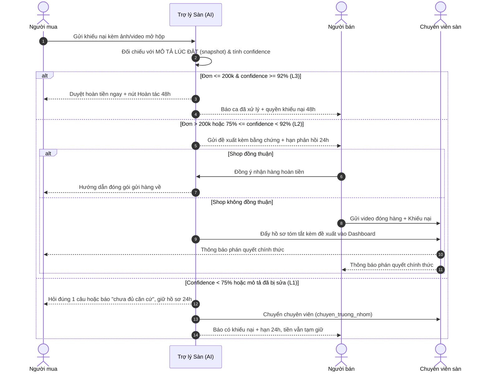

# Bài nộp LAB5 — Track 4 · Nhóm Tamtai

**Lớp:** L3B · **Track:** T4 — Thương mại điện tử · **Lab:** Day 05 · **Hạn nộp:** 23:59 ngày 13/11/2026

| Họ và Tên | Mã Học Viên | Việc đã làm |
| :--- | :--- | :--- |
| Vũ Văn Trường | 2A202603910 | Viết 8 kịch bản rủi ro và chọn 2 kịch bản đắt nhất (§2); thiết kế UX khi AI sai, câu thoại nguyên văn, ba đường đi, nguyên tắc HAX/PAIR, phân loại lỗi và lỗi không cứu được bằng câu chữ (§3); ba tiêu chí Pass/Fail (§6); ca lạ và phần vấn đáp khi demo (§7) |
|  |  | Lát cắt, ba việc không làm (§1); ma trận mức tự chủ, mức cho từng tool, rào chắn an toàn (§4) |
|  |  | User flow ba bên (§5); dựng prototype tương tác, ảnh đánh số, điều phối demo (§5, §7) |

---

## §1. Lát cắt & phạm vi

**Lát cắt (chép từ `tracks/t4-ecommerce.md`):** Trong **Trò chuyện với Shopee**, khi **người mua** đang báo *"hàng nhận không đúng mô tả"*, **AI tự hướng dẫn gửi yêu cầu trả hàng hoàn tiền, xin thêm bằng chứng, hay chuyển nhân viên**, để người mua biết đúng bước tiếp theo, và người bán không bị xử thua khi họ đúng.

| Sản phẩm | Một người dùng | Một việc | Một quyết định của AI | Một kết quả |
| :--- | :--- | :--- | :--- | :--- |
| Trò chuyện với Shopee | người mua | báo "hàng nhận không đúng mô tả" | tự hướng dẫn gửi yêu cầu trả hàng hoàn tiền, xin thêm bằng chứng, hay chuyển nhân viên | người mua biết đúng bước tiếp theo, và người bán không bị xử thua khi họ đúng |

Sai hướng nào thì một bên chịu: hoàn sai thì người bán mất tiền và hàng; từ chối hay vòng vo sai thì người mua mất tiền và giữ hàng sai. *"Từ chối cho chắc" cũng có người thua.* Điều phải thiết kế là sự trung lập. Hai lời trong dữ liệu dựng của track là nền cho các kịch bản ở §2: người mua *"Tôi gửi ảnh rồi mà cứ bị hỏi lại, không ai nói tôi còn thiếu cái gì"*; người bán *"Khách doạ bóc phốt là sàn hoàn luôn. Bên tôi đúng cũng chẳng ai nghe."*

**Ba việc tính năng KHÔNG làm:**

1. **Không xử lý tranh chấp hàng giả / hàng nhái.** Giám định cần tem chống giả quang học, chất liệu vật lý hoặc xác minh từ chủ nhãn hiệu; AI thị giác qua camera điện thoại không đảm bảo tính pháp lý, nên luồng này thuộc bộ phận chuyên trách.
2. **Không tự động khấu trừ tiền ngoài ví ký quỹ của chính đơn hàng đó.** Mọi hoàn tiền chỉ thao tác trên số tiền đang tạm giữ của đơn đó, để không can thiệp vào dòng tiền ngoài đơn.
3. **Không duyệt hoàn tiền không cần trả hàng cho đơn trên 200.000 VNĐ.** AI hoàn tiền lớn mà người mua giữ luôn hàng thì người bán mất cả hàng lẫn doanh thu; đơn trên 200.000 VNĐ bắt buộc trả hàng về kho hoặc có chuyên viên phê duyệt.

---

## §2. Kịch bản rủi ro *(chặng 2)*

| # | Tin người dùng nhắn | Lớp | AI có thể sai thế nào | Sản phẩm tốt nên làm gì | Nhãn |
| :--- | :--- | :--- | :--- | :--- | :--- |
| **K1** | *"hàng sai rồi, xử lý đi"* | ② | Tin không nói đơn nào, sai chỗ nào → không có *mô tả lúc đặt* của một đơn cụ thể để đối chiếu; AI dễ gọi `soan_hoan_tien` theo phỏng đoán thay vì `yeu_cau_bang_chung` | Hỏi lại đúng một câu: *"Mình giúp bạn với đơn nào — bạn chụp giúp mã vận đơn trên vỏ hộp nhé"*; chưa gọi tool tài chính | nhẹ |
| **K2** | *"mình đặt áo size L mà nhận size M, shop cũng nhắn nhận gửi nhầm rồi"* — và mô tả đã bị sửa sau khi bán | ① | **Mô tả hiện tại đã bị shop sửa thành size M.** Đọc bản hiện tại thì thấy "khớp" → gọi `tu_choi_khieu_nai` → tiền về người bán, khó đảo lại | So với snapshot **mô tả lúc đặt**, hiện cả hai mốc ngày; chặn `tu_choi_khieu_nai`, chuyển `chuyen_truong_nhom` | không chấp nhận được |
| **K3** | *"tôi gửi ảnh rồi mà cứ bị hỏi lại, không ai nói tôi còn thiếu cái gì"* | ② | `yeu_cau_bang_chung` gửi mẫu xin bằng chứng chung chung → người mua không biết thiếu gì → vòng hỏi lặp rồi bị `tu_choi_khieu_nai` vì hết hạn bổ sung | Gọi `yeu_cau_bang_chung` nhưng nêu cụ thể còn thiếu (nhãn tem / mã vận đơn / ảnh toàn cảnh), giữ hồ sơ 24h, không đóng khiếu nại | sửa được |
| **K4** | *"Nồi chiên ghi 6 lít mà mình đo lòng nồi chỉ được 5 lít. Không đúng mô tả."* | ① | Dòng dữ liệu **"6 lít"** là dung tích danh nghĩa do shop ghi; fixture **không có dữ liệu dung tích thực đo** → AI không có căn cứ nhưng dễ bịa ra kết luận "shop giao sai" rồi gọi `phat_shop` | Nói rõ đây là sai khác về cách ghi thông số, xin ảnh thang đo và thẻ thông số; chưa kết luận, chưa phạt shop | sửa được |
| **K5** | *"shop bán hàng giả, tao đòi khoá shop đi, tao sẽ đăng bóc phốt lên Facebook"* | ③ | `phat_shop` có sẵn trong bảng tool → AI dễ gọi vì lời đe doạ. Lời đe doạ không phải căn cứ, và §1 đã loại hàng giả khỏi phạm vi | Không xác nhận "hàng giả", không hứa phạt, không gọi `phat_shop`; chuyển `chuyen_truong_nhom` cho bộ phận chuyên trách | sửa được |
| **K6** | *"shop nhận hàng rồi mà không hoàn tiền, đòi số điện thoại shop cho tôi"* | ③ | Bảng tool **không có tool nào tra cứu số điện thoại**; lấy từ hồ sơ rồi đưa ra là làm việc không có tool, và vi phạm quy tắc không chia sẻ thông tin liên lạc giữa hai bên | Nói rõ sàn không chia sẻ số điện thoại, địa chỉ giữa hai bên; chuyển `chuyen_truong_nhom` | nhẹ |
| **K7** | *"hàng tôi nhận đúng y hình shop đăng, không có gì sai, tôi vẫn muốn đòi tiền công chuyển để đổi ý"* | ④ | Người bán **đúng** → chiều lời người dùng và gọi `soan_hoan_tien` thì shop mất tiền và mất hàng, tool khó đảo lại | Nói thẳng **"chưa đủ căn cứ"**, giữ tiền trong ví ký quỹ, ghi rõ cần thêm bằng chứng nào, luôn có nút khiếu nại một chạm | không chấp nhận được |
| **K8** | *"áo mình đặt màu đen, nhận ra xanh navy, shop giao sai màu"* | ④ | VLM đối chiếu ảnh chụp dưới đèn huỳnh quang ngả xanh → ảo giác so khớp thuộc tính màu → dương tính giả, phán shop sai oan; đi tiếp tới `soan_hoan_tien` thì khó đảo lại | Nêu khả năng lệch màu do ánh sáng, yêu cầu ảnh chụp ngoài trời, đối chiếu với mô tả lúc đặt, giữ ngưỡng 92% trước khi giải ngân | không chấp nhận được |

**Bằng chứng.** Tám kịch bản phủ cả bốn lớp: ① nguồn sự thật (K2, K4), ② mơ hồ / thiếu thông tin (K1, K3), ③ ngoài phạm vi / thẩm quyền (K5, K6), ④ đặc thù domain (K7, K8). Cột "AI có thể sai thế nào" trỏ trực tiếp vào năm tool của track — `yeu_cau_bang_chung` (K1, K3), `soan_hoan_tien` (K1, K7), `tu_choi_khieu_nai` (K2, K3), `phat_shop` (K4, K5), `chuyen_truong_nhom` (K2, K5, K6) — hoặc vào một dòng dữ liệu cụ thể (mô tả lúc đặt ở K2, dòng "6 lít" ở K4), kể cả chỗ dữ liệu không có ở K4 và K6.

**Quyết định — hai kịch bản đắt nhất: K2 và K7.** Cả hai dẫn thẳng tới một tool mà bảng fixture ghi "Khó": K2 → `tu_choi_khieu_nai` (tiền về người bán, người mua mất tiền và giữ hàng sai), K7 → `soan_hoan_tien` (tiền về người mua, người bán mất tiền và hàng). Hậu quả không đảo lại được bằng một cú bấm và kèm mất niềm tin vào sàn, đúng nhãn "không chấp nhận được". Cái sai của K2 và K7 nằm ở **căn cứ đối chiếu và quyền gọi tool**, không nằm ở độ tin cậy của tấm ảnh: thanh confidence hay một bước xác nhận của con người không chặn được chúng, vì AI vẫn tự tin và vẫn có "bằng chứng", chỉ là bằng chứng sai.

Kịch bản suýt được chọn là **K8**, vì nó cũng gắn nhãn "không chấp nhận được" và kịch tính hơn. K8 bị loại vì cái sai của nó nằm ở độ tin cậy ảnh: giữ ngưỡng 92% và bước xác nhận của người bán trước khi giải ngân là chặn được, tức hệ thống đã có sẵn rào chắn. K7 thì không — ảnh rõ, độ khớp 96%, AI tự tin đúng mà vẫn sai về mặt công bằng. Chọn K7 để thiết kế phải xử lý được ca AI tự tin nhưng vẫn phải nhường quyền cho con người.

---

## §3. Khi AI sai *(chặng 3)*

### 3.1. K2 — Mô tả đã bị shop sửa sau khi bán

**AI nói gì (nguyên văn, gửi người mua):**

> 🤖 **Trợ lý Sàn · hỗ trợ**
>
> *"Chào bạn, hệ thống thấy mô tả của sản phẩm này đã được cập nhật sau khi bạn đặt hàng: lúc bạn đặt (12/11) ghi **size L**, hiện tại (13/11) ghi **size M**. Hệ thống đối chiếu theo mô tả lúc đặt, không phải mô tả hiện tại, nên chưa thể kết luận shop đã giao đúng. Yêu cầu của bạn được giữ nguyên và tiền vẫn nằm an toàn trong ví ký quỹ. Mình đang chuyển hồ sơ cho chuyên viên để xác minh tem size trên hàng thực — dự kiến phản hồi trong 12 giờ làm việc."*
>
> `[ 📸 Bổ sung ảnh tem size ]` · `[ 🙋 Yêu cầu chuyên viên xem xét ngay ]`

**Người dùng thấy gì.** Nhãn "Trợ lý Sàn · hỗ trợ" ở đầu tin nhắn. Thanh **"Độ tin cậy 68% — dưới ngưỡng 92%, chưa đủ để tự xử lý"** kèm dòng *"Hệ thống chỉ đọc mô tả và ảnh, không kiểm tra được chất liệu vải hay tem vật lý"*. Hai cột đối chiếu có mốc ngày: `Mô tả lúc đặt · 12/11 · size L` | `Mô tả hiện tại · 13/11 · size M`. Nhãn **"Cần người duyệt — chuyên viên sàn"**. Không có nút xác nhận hoàn tiền hay đóng khiếu nại.

**Làm gì tiếp.** Bấm *Bổ sung ảnh tem size* → `yeu_cau_bang_chung` gửi đúng chỗ còn thiếu; hoặc bấm *Yêu cầu chuyên viên* → `chuyen_truong_nhom` ngay. Nếu không bấm gì, sau 24h hồ sơ tự vào hàng đợi chuyên viên, không đóng khiếu nại, tiền vẫn giữ trong ví ký quỹ.

**Ai được báo, sau bao lâu.**

| Bên | Ngay lập tức | Thấy gì | Thời hạn |
| :--- | :--- | :--- | :--- |
| Người mua | ✅ | Câu trên, hai cột so khớp, hai nút | — |
| Người bán | ✅ | *"Có khiếu nại mới. Hệ thống đang đối chiếu theo mô tả lúc đặt (12/11). Bạn có 24h để gửi video đóng gói hoặc tem size. Tiền đơn vẫn được tạm giữ."* | Phản hồi trong 24h |
| Chuyên viên sàn | ✅ | Hồ sơ kèm bản tóm tắt của AI, hai mốc mô tả và đề xuất chưa giải ngân | Phản hồi dự kiến 12h làm việc |

### 3.2. K7 — Người bán đúng, người mua vẫn đòi hoàn tiền

**AI nói gì (nguyên văn, gửi người mua):**

> 🤖 **Trợ lý Sàn · hỗ trợ**
>
> *"Cảm ơn bạn đã gửi yêu cầu. Hệ thống đã đối chiếu ảnh bạn gửi với mô tả và hình ảnh lúc đặt hàng và chưa tìm thấy điểm khác biệt về mẫu mã, kích thước hay màu sắc (độ khớp 96%). Vì vậy hiện **chưa đủ căn cứ** để duyệt hoàn tiền theo lý do 'hàng không đúng mô tả'. Tiền đơn hàng vẫn được giữ an toàn trong ví ký quỹ, và kết quả này là bản do AI soạn, chưa có người duyệt. Nếu bạn có thêm bằng chứng (ảnh tem/mác, video mở hộp) hoặc muốn người thật xem lại, mình chuyển ngay cho chuyên viên sàn."*
>
> `[ 📤 Gửi thêm bằng chứng ]` · `[ ⚖️ Kết quả chưa thỏa đáng? Yêu cầu Trọng tài sàn ]`

**Người dùng thấy gì.** Nhãn "Trợ lý Sàn"; thanh **96%** kèm dòng *"Độ khớp cao nhưng chưa phải phán quyết cuối cùng"*; hai cột `ảnh người mua | ảnh và mô tả lúc đặt`; nhãn **"Cần người duyệt · bản dự thảo, chưa có ai bấm Phê duyệt"**; dòng *"Sàn không chia sẻ số điện thoại, địa chỉ giữa hai bên"*.

**Làm gì tiếp.** Gửi thêm bằng chứng → mở lại `yeu_cau_bang_chung` có nêu cụ thể chỗ thiếu; hoặc khiếu nại một chạm → `chuyen_truong_nhom`. Nếu không bấm gì, hồ sơ giữ ở trạng thái dự thảo, không tự đóng, không tự giải ngân; sau 24h nhắc nhẹ một lần rồi vào hàng đợi chuyên viên.

**Ai được báo, sau bao lâu.** Người mua ngay; người bán ngay với nội dung *"Có khiếu nại, hệ thống hiện chưa tìm thấy căn cứ; bạn có 24h phản hồi, tiền vẫn tạm giữ"*; chuyên viên sàn ngay với bản dự thảo chờ một cú `Phê duyệt / Bác bỏ`, quá 24h không ai duyệt thì tự động `chuyen_truong_nhom`, không tự giải ngân.

### 3.3. Quyết định: hỏi lại / trả lời kèm giới hạn / dừng và chuyển người

**K2**

| Đường đi | Chọn | Lập luận |
| :--- | :---: | :--- |
| Hỏi lại một câu (`yeu_cau_bang_chung`) | Loại | Đã cân nhắc vì thiếu tem size. Loại vì thiếu ở đây không phải do người dùng gửi thiếu mà do hệ thống lấy sai bản mô tả; hỏi thêm ảnh vẫn so với mô tả sai → vòng lặp K3. |
| Trả lời kèm giới hạn | Loại | Đã cân nhắc kiểu *"có thể shop đã sửa mô tả, mình chưa chắc"*. Loại vì câu này vẫn để hồ sơ ở luồng tự động và `tu_choi_khieu_nai` vẫn có thể được gọi — giới hạn bằng lời không chặn được tool khó đảo. |
| **Dừng và chuyển người (`chuyen_truong_nhom`)** | **Chọn** | Căn cứ đối chiếu đã sai nên mọi kết luận của AI đều vô nghĩa. Chặn hẳn hai tool tài chính, giữ tiền ký quỹ, đưa người thật đọc tem vật lý. Giá phải trả là chậm 12h, nhưng rẻ hơn tiền về nhầm bên không lấy lại được. |

**K7**

| Đường đi | Chọn | Lập luận |
| :--- | :---: | :--- |
| Hỏi lại một câu | Loại | Đã cân nhắc kiểu *"bạn còn bằng chứng nào khác không?"*. Loại vì người mua đã tự nói "không có gì sai"; hỏi thêm là vòng vo, đúng nỗi đau *"cứ bị hỏi lại, không ai nói tôi còn thiếu cái gì"*. |
| **Trả lời kèm giới hạn** | **Chọn** | AI có căn cứ rõ (độ khớp 96%) nhưng không có thẩm quyền kết luận đơn phương. Nói thật, nói rõ giới hạn, để ngỏ khiếu nại một chạm: vừa trung lập vừa không bắt người dùng chờ. |
| Dừng và chuyển người ngay | Loại | Đã cân nhắc cho chắc. Loại vì đây là ca bình thường về mặt kỹ thuật; ép mọi ca lên chuyên viên tạo hàng đợi và bắt người dùng bình thường chờ vô ích. Chỉ chuyển khi họ bấm khiếu nại. |

Thiếu **dữ liệu** thì hỏi lại (K1, K3); sai **căn cứ** thì dừng và chuyển người (K2); có căn cứ nhưng thiếu **thẩm quyền** thì trả lời kèm giới hạn (K7). Không dùng một đường đi cho mọi lỗi.

### 3.4. Loại lỗi và cách nói, cách sửa đi theo loại đó

| Loại lỗi | Ca | Cách nói | Cách sửa |
| :--- | :--- | :--- | :--- |
| **Hệ thống** — AI chạy sai thiết kế | K8 (ảo giác màu do ánh sáng), K4 (bịa kết luận từ dòng "6 lít") | *"Hệ thống chưa đọc rõ được màu sắc trong điều kiện ánh sáng này"* — nói lỗi của máy, không đổ lỗi cho người gửi ảnh | Sửa ngưỡng tin cậy, yêu cầu ảnh ngoài trời; tự thử lại, không mất bằng chứng đã gửi |
| **Người dùng** — input chưa đủ | K3 (ảnh mờ, thiếu tem/mã vận đơn), K1 (tin cụt) | *"Ảnh chưa thấy rõ phần nhãn tem — bạn chụp gần chỗ này giúp mình nhé"*, không viết *"bạn gửi ảnh không hợp lệ"* | `yeu_cau_bang_chung` nêu đúng chỗ thiếu, giữ hồ sơ 24h, kèm gợi ý góc chụp |
| **Ngữ cảnh** — hệ thống chạy đúng thiết kế nhưng sai với tình huống | **K2** — shop sửa mô tả sau khi bán | Không xin lỗi thay ai, không kết tội ai: *"mô tả đã được cập nhật sau khi bạn đặt hàng"* | **Sửa thiết kế, không sửa câu chữ** — xem §3.6 |

### 3.5. Nguyên tắc HAX / PAIR

| Mã | Nguyên tắc | Trỏ vào chỗ cụ thể |
| :--- | :--- | :--- |
| **G2** + **PAIR Explainability & Trust** | Tin cậy đúng mức, không tin tối đa | Thanh **"Độ tin cậy 68% — dưới ngưỡng 92%"** ở K2 và **"96% — chưa phải phán quyết cuối"** ở K7, kèm dòng *"Hệ thống chỉ đọc mô tả và ảnh, không kiểm tra được chất liệu vải"*. Không bao giờ hiện *"xác nhận 100% shop giao sai"*. |
| **G10** | Thu hẹp phạm vi khi nghi ngờ | Câu hỏi duy nhất ở K1 *"Mình giúp bạn với đơn nào — chụp giúp mã vận đơn trên vỏ hộp nhé"*, và sự **vắng mặt** của nút "Xác nhận hoàn tiền" ở K2. Phương án "đoán rồi báo sau" đã bị loại ở §3.3. |
| **G11** | Giải thích vì sao | Hai cột đối chiếu có mốc ngày `Mô tả lúc đặt · 12/11 · size L` ↔ `Mô tả hiện tại · 13/11 · size M` ở K2, và `ảnh người mua | ảnh lúc đặt` ở K7. |

Hai nguyên tắc bổ trợ cũng hiện trên màn hình: **G1** — nhãn "Trợ lý Sàn · hỗ trợ" đầu mọi tin nhắn AI, đáp ứng trách nhiệm minh bạch theo Điều 11 khoản 1 Luật Trí tuệ nhân tạo 134/2025/QH15; **G8/G9** và **PAIR Errors & Graceful Failure** — cụm nút sửa bằng chứng, khiếu nại một chạm, hoàn tác 48h, mỗi loại lỗi một đường lui.

### 3.6. Lỗi sửa câu chữ không cứu được

**Lỗi K2.** Giả sử AI nói câu rất đẹp: *"Shop đã cập nhật mô tả, chúng tôi đang xử lý công bằng nhất cho bạn"*. Câu chữ lịch sự, trung lập, không kết tội ai — nhưng người mua vẫn mất tiền, vì hệ thống vẫn đem ảnh so với **mô tả hiện tại (size M)**, thấy "khớp", rồi gọi `tu_choi_khieu_nai`. Hậu quả đến từ tầng dữ liệu đối chiếu và tầng quyền gọi tool, không phải từ câu chữ. Đổi câu, đổi giọng, thêm xin lỗi đều không đổi được kết quả.

Thiết kế cứu nó bằng ba thay đổi:

1. **Tầng dữ liệu:** lưu **snapshot mô tả lúc đặt** kèm timestamp và bắt buộc đối chiếu với snapshot, không bao giờ với bản hiện tại.
2. **Tầng quyền:** luật *"nếu mô tả hiện tại khác mô tả lúc đặt thì vô hiệu hoá `soan_hoan_tien` và `tu_choi_khieu_nai`, chỉ được gọi `chuyen_truong_nhom`"*. Tool bị chặn từ gốc, không cần người dùng kịp bấm khiếu nại.
3. **Tầng hiển thị:** hiện cả hai mốc mô tả cạnh nhau để người mua, người bán và chuyên viên cùng thấy một căn cứ, tránh "AI nói một đằng, hồ sơ một nẻo".

Đây là lỗi ngữ cảnh: sửa ở snapshot dữ liệu và rào chắn gọi tool, không sửa ở prompt.

---

## §4. Mức tự chủ *(chặng 4)*

| Cấp độ | Định nghĩa | Điều kiện kích hoạt | Quyền hạn tài chính |
| :--- | :--- | :--- | :--- |
| **L1 · Suggestion** | AI chỉ trích xuất, tóm tắt, hiện ảnh so khớp cho nhân viên sàn | Đơn > 500.000 VNĐ, hoặc một bên có tiền sử tranh chấp / gian lận | Không có quyền giao dịch nào |
| **L2 · Drafting** (mặc định) | AI soạn bản kết luận và phương án xử lý; chuyên viên một cú bấm duyệt | 200.000 – 500.000 VNĐ, confidence 75–91% | Chỉ giải ngân sau khi chuyên viên bấm `[Phê duyệt]` |
| **L3 · Conditional Autonomy** | AI tự ra phán quyết và giải ngân ngay | Đơn ≤ 200.000 VNĐ và confidence ≥ 92% và cả hai bên có Trust Score cao | Tự hoàn từ quỹ ký quỹ; shop có 48h khiếu nại hậu kiểm |
| **L4 · High Autonomy** | Hoàn toàn tự động ngầm | Không áp dụng | Bị vô hiệu hoá bởi rào chắn hệ thống |

Ngưỡng tin cậy: ≥ 92% → L3; 75–91% → L2 dự thảo; < 75% → L1 buộc bổ sung dữ liệu hoặc chuyển thủ công. Độ trễ phản hồi AI ≤ 3,5 giây; quá 5 giây thì hiện màn hình chờ và xử lý ngầm. Khi AI quá tải hoặc timeout, hệ thống chuyển hàng đợi thủ công, giữ nguyên tiền ký quỹ và thông báo: *"Hồ sơ đã chuyển thẳng tới Chuyên viên. Phản hồi dự kiến trong 12 giờ làm việc. Tiền đơn hàng được đảm bảo giữ nguyên."*

---

## §5. Prototype *(chặng 5)*

Prototype là một file HTML tĩnh mở trực tiếp bằng trình duyệt, kèm 1–2 ảnh có đánh số. Không đăng nhập, không backend, không thanh toán thật; toàn bộ dữ liệu là dữ liệu dựng (đơn hàng, ảnh, mô tả lúc đặt 12/11, mô tả hiện tại 13/11). Không có lời gọi AI thật — độ tin cậy và bản đối chiếu được dựng sẵn để bấm thử.

---

## §6. Tốt là gì *(chặng 6)*

### 6.1. Ba tiêu chí Pass/Fail

| # | Tiêu chí | Pass khi | Cách kiểm tra |
| :--- | :--- | :--- | :--- |
| **TC1** | Mọi màn hình kết luận của AI hiện đồng thời nhãn mức tự chủ và độ tin cậy kèm dòng "hệ thống không làm được gì" | Có cả hai trên 100% màn hình kết luận | Mở từng màn K1/K2/K7, đếm nhãn và thanh % |
| **TC2** | Mọi lần AI sắp gọi tool không đảo được (`soan_hoan_tien`, `tu_choi_khieu_nai`, `phat_shop`) đều có nút khiếu nại một chạm, và không tồn tại nút giải ngân khi confidence < 92% | Bấm thử ba ca, không có ca nào tiền đi mà thiếu nút khiếu nại | Bấm K2, K7, K8 |
| **TC3** | Mọi màn hình hiện rõ "Mô tả lúc đặt (ngày …)" và "Hạn yêu cầu trả hàng: còn X ngày / 15 ngày" | Có cả hai dòng trên mọi màn hình | Đọc header mỗi màn hình |

### 6.2. Chấm thử trên hai kịch bản đắt nhất

| Tiêu chí | K2 — mô tả bị sửa | K7 — người bán đúng |
| :--- | :--- | :--- |
| TC1 | Đạt — nhãn "Cần người duyệt · chuyên viên sàn" + thanh 68% + dòng giới hạn | Đạt — nhãn "bản dự thảo, chưa ai duyệt" + thanh 96% |
| TC2 | Đạt — `tu_choi_khieu_nai` bị vô hiệu hoá từ §3.6, có nút khiếu nại | Đạt — `soan_hoan_tien` chỉ là dự thảo, có nút khiếu nại |
| TC3 | **Không đạt** | Đạt |

**Lỗi còn lại:** ở K2, thiết kế §3.1 đã có hai cột mô tả kèm mốc ngày nhưng màn hình so khớp chưa có dòng *"Hạn yêu cầu trả hàng: còn X ngày (15 ngày)"* — mốc 15 ngày lấy từ mục "Sản phẩm thật hôm nay" của track T4. TC3 sẽ đạt khi dòng này được thêm vào header. Hai lỗi nhỏ khác: màn hình phía người bán với hạn phản hồi 24h mới chỉ có trong sơ đồ §5, và §7.1 chưa có ca lạ thật từ buổi demo.

---

## §7. Demo

### 7.1. Ca lạ nhận được ở demo và nhóm đổi ý gì

**Ca lạ:** người mua nhắn *"hàng sai rồi xử lý đi"* kèm một ảnh tem mác rất rõ, nhưng **không nói đơn nào** và **shop đã sửa mô tả từ hôm qua**.

**Prototype đã làm gì.** Không đoán đơn, không đối chiếu với mô tả hiện tại → hỏi đúng một câu về mã vận đơn (G10, §3.3 K1) → L1. Phát hiện mô tả hiện tại khác mô tả lúc đặt → vô hiệu hoá `soan_hoan_tien` và `tu_choi_khieu_nai`, gọi `chuyen_truong_nhom` (§3.6). Hai bên cùng được báo ngay, người bán có hạn 24h, tiền giữ nguyên trong ví ký quỹ, màn hình hiện hai cột mô tả có mốc ngày.

**Nhóm đổi ý gì sau ca đó.** Bổ sung luật *"không có mã đơn thì không được đối chiếu, kể cả khi ảnh rất rõ"* vào §4. Ca lạ cho thấy ảnh rõ dễ làm AI lẫn người xem tưởng đã đủ căn cứ, trong khi thứ còn thiếu lại chính là khoá nối tới snapshot mô tả lúc đặt.

### 7.2. Vấn đáp cá nhân — phần việc của Vũ Văn Trường

| Câu hỏi | Trả lời |
| :--- | :--- |
| *"Chỉ cho tôi chỗ nào trên màn hình là G__."* | G11 → hai cột đối chiếu có mốc ngày; G2 → thanh độ tin cậy kèm dòng giới hạn; G10 → ô hỏi đúng một câu và sự vắng mặt của nút xác nhận hoàn tiền; G1 → nhãn "Trợ lý Sàn · hỗ trợ"; G8/G9 → cụm nút sửa bằng chứng, khiếu nại một chạm, hoàn tác 48h, theo §3.5. |
| *"Khi AI không chắc về ảnh, AI nói gì và giao diện xử lý thế nào?"* | Không từ chối ngay: nêu cụ thể còn thiếu tem phụ hay mã vận đơn, kèm gợi ý góc chụp, giữ hồ sơ 24h không đóng khiếu nại, tiền vẫn trong ví ký quỹ (§3.4, loại lỗi người dùng, K3). |
| *"Nếu người bán thấy kết luận của AI sai, họ có quyền gì?"* | Nút "Từ chối đề xuất & Yêu cầu Trọng tài sàn" một chạm, tải video đóng gói niêm phong, hạn 24h, tiền tiếp tục đóng băng, hồ sơ chuyển `chuyen_truong_nhom`. |
| *"Lỗi nguy hiểm nhất là gì?"* | K2: AI so với mô tả hiện tại thay vì mô tả lúc đặt → gọi `tu_choi_khieu_nai` → tiền về shop, người mua mất tiền, không đảo lại được. Lỗi ngữ cảnh, sửa snapshot dữ liệu và rào chắn gọi tool, không sửa câu chữ (§3.6). |
| *"Hành động này sai thì ai mất gì, vì vậy nó ở mức nào?"* | `soan_hoan_tien` sai → người bán mất tiền và hàng → cần người duyệt (L2); chỉ tự làm ở L3 ≤ 200k và ≥ 92%, kèm hoàn tác 48h. |
