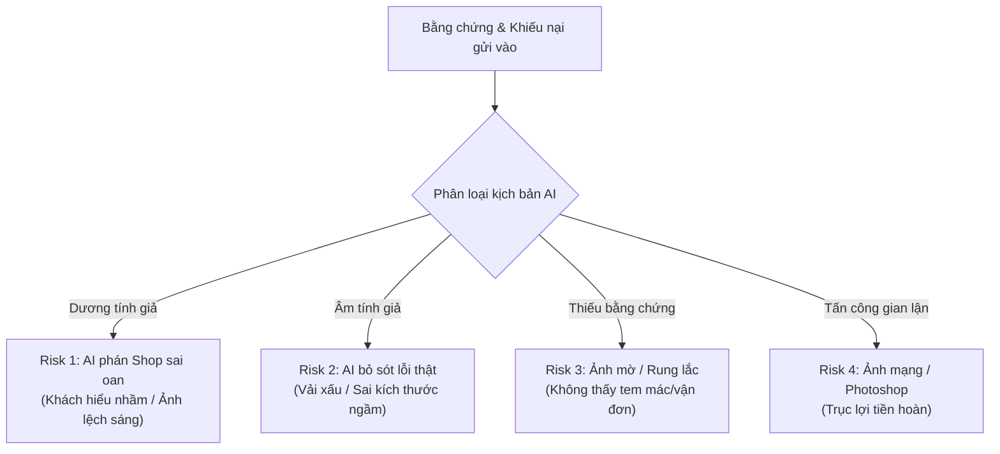
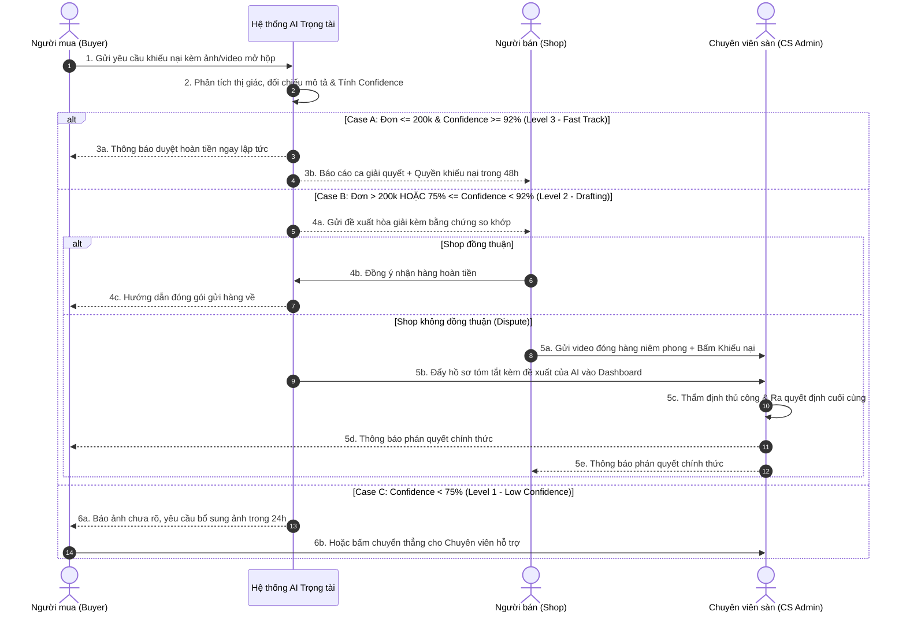

# TÀI LIỆU ĐẶC TẢ SẢN PHẨM AI (AI PRODUCT SPECIFICATION)
## HỆ THỐNG AI HÒA GIẢI & XỬ LÝ TRANH CHẤP "HÀNG KHÔNG ĐÚNG MÔ TẢ" (AI DISPUTE RESOLUTION)

> **Chương trình:** VinUni - Vingroup AI20k | Khóa K5 - Level 3  
> **Bài tập thực hành:** Day 05 — Tích hợp AI vào sản phẩm thật: UX khi AI sai, Mức tự chủ & Prototype  
> **Track:** Track 4 — Thương mại điện tử (E-commerce)  
> **Nhóm thực hiện:** Team 4 (Tamtai)  
> **Trạng thái tài liệu:** Đã hoàn thiện cấu trúc & Khớp kế hoạch triển khai  

---

## 👥 BẢNG PHÂN CÔNG CÔNG VIỆC NHÓM (TEAM MATRIX)

| Họ và Tên | Mã Học Viên | Vai trò chính | Phần việc phụ trách trong Spec | Trách nhiệm Prototype & Bảo vệ |
| :--- | :--- | :--- | :--- | :--- |
| *(Thành viên 1)* | *(Mã HV 1)* | **Product & Autonomy Lead** | - §1: Lát cắt & 3 việc KHÔNG làm - §4: Mức tự chủ L1-L4 & Ma trận rủi ro - §6: Yêu cầu kỹ thuật & Guardrails | Thiết kế logic phân quyền, bảo vệ cơ sở chọn mức tự chủ trước hội đồng. |
| *(Thành viên 2)* | *(Mã HV 2)* | **UX & Error States Lead** | - §2: 4 Kịch bản rủi ro khi AI sai - §3: UX khi AI sai & Lời thoại nguyên văn - §7: Tiêu chí nghiệm thu (DoD) | Thiết kế giao diện báo lỗi, cơ chế 1-Click Appeal và hoàn thiện bộ copy. |
| *(Thành viên 3)* | *(Mã HV 3)* | **Prototype & User Flow Lead** | - §5: User Flow chi tiết 3 bên - Xây dựng Web Prototype tương tác - Kịch bản Demo 5 phút | Lập trình Web Prototype, điều phối demo trực tiếp các luồng lỗi của AI. |

---

## §1. LÁT CẮT & PHẠM VI SẢN PHẨM (SCOPE & BOUNDARIES)

### 1.1. Bối cảnh kinh doanh & Vấn đề thực tế (Problem Statement)
* **Thực trạng sàn TMĐT:** Hàng ngày phát sinh hàng chục ngàn khiếu nại trả hàng/hoàn tiền. Trong đó, khiếu nại **"Hàng không đúng mô tả"** chiếm hơn 45% tổng lượng tranh chấp, đòi hỏi đối chiếu phức tạp giữa ảnh/video bóc hàng của người mua và thông tin shop đăng bán.
* **Nỗi đau của 3 bên:**
  * **Người mua:** Thời gian chờ sàn xử lý lâu (3–7 ngày), tiền bị đóng băng, ức chế khi gặp sản phẩm lỗi mà quy trình giải quyết rườm rà.
  * **Người bán:** Dễ bị người mua lừa đảo (Friendly Fraud — nhận hàng đúng nhưng chụp ảnh hàng cũ để đòi tiền), mất cả sản phẩm lẫn doanh thu nếu sàn thiên vị khách hàng.
  * **Sàn TMĐT (Platform CS):** Chi phí nhân sự thẩm định thủ công quá lớn, thời gian phản hồi chậm làm tăng tỷ lệ rời bỏ nền tảng (churn rate).
* **Tại sao giải pháp AI vượt trội hơn Rule-based & Human thuần túy:**
  * *So với Rule-based:* Rule cứng không thể phân tích thị giác (Computer Vision/VLM) để so khớp màu sắc, phom dáng, họa tiết, hoặc đọc hiểu ngữ cảnh giữa video mở hộp và mô tả sản phẩm.
  * *So với Human thuần túy:* AI phản hồi trong **3 giây** thay vì 48 giờ, giúp giải quyết tức thì các ca tranh chấp rõ ràng, giảm 70% tải công việc cho đội ngũ thẩm định viên.

### 1.2. Lát cắt tính năng xác định (Vertical Slice)
Hệ thống tập trung duy nhất vào luồng: **Thẩm định tự động & Hòa giải đa bên cho khiếu nại "Hàng không đúng mô tả"** (áp dụng cho nhóm ngành hàng Thời trang, Phụ kiện, Đồ gia dụng tiêu chuẩn).

### 1.3. BA VIỆC QUAN TRỌNG HỆ THỐNG KHÔNG LÀM (OUT-OF-SCOPE) & LÝ DO

1. **KHÔNG xử lý tranh chấp hàng giả / hàng nhái (Counterfeit / IP Infringement):**
   * *Lý do:* Giám định hàng nhái tinh vi (Super Fake) đòi hỏi đối chiếu tem chống giả quang học, chất liệu vật lý thực tế hoặc xác minh trực tiếp từ chủ sở hữu nhãn hiệu. AI thị giác qua camera điện thoại không thể đảm bảo tính pháp lý, nguy cơ bị kiện ngược là cực kỳ cao.
2. **KHÔNG tự động khấu trừ tiền trực tiếp từ tài khoản ngân hàng của Người bán:**
   * *Lý do:* Mọi quyết định hoàn tiền đều chỉ được thực hiện trên số tiền đang tạm giữ trong ví ký quỹ (Escrow Wallet) của đơn hàng đó. Tuyệt đối không can thiệp vào dòng tiền ngoài đơn hàng để tránh rủi ro pháp lý tài chính.
3. **KHÔNG tự động duyệt hoàn tiền 100% không cần trả hàng (Refund-only) cho đơn hàng giá trị cao (> 200.000 VNĐ):**
   * *Lý do:* Rủi ro "trục lợi chính sách" (Exploitation). Nếu AI tự động hoàn tiền lớn mà khách giữ luôn hàng, người bán sẽ bị thiệt hại nặng và rời bỏ sàn. Các đơn trên 200.000 VNĐ bắt buộc phải yêu cầu trả hàng về kho hoặc có chuyên viên con người phê duyệt.

---

## §2. KỊCH BẢN RỦI RO KHI AI SAI (RISK SCENARIOS)

Do bản chất bất định của mô hình AI thị giác và ngôn ngữ, hệ thống xác định 4 kịch bản lỗi cốt lõi:

### Kịch bản 1: Dương tính giả (False Positive) — AI kết luận oan cho Người bán
* **Tình huống:** Người mua khiếu nại "Áo giao sai màu: Đặt đen nhưng nhận xanh đen". Thực tế sản phẩm là màu đen, nhưng do camera điện thoại người mua chụp dưới ánh đèn huỳnh quang màu vàng ngả xanh, AI VLM phân loại nhầm thành màu Navy và kết luận Shop giao sai.
* **Hậu quả nếu AI tự động xử lý:** Shop mất tiền oan, khiếu nại gay gắt lên sàn.

### Kịch bản 2: Âm tính giả (False Negative) — AI bỏ sót sai phạm của Người bán
* **Tình huống:** Người mua đặt mua "Áo 100% Cotton", nhận về áo chất liệu Nilon bóng mỏng tanh, sờ ráp tay. Do hình ảnh chụp từ xa nhìn hình in bên ngoài giống hệt ảnh mẫu của Shop, AI kết luận "Sản phẩm khớp 98% với mô tả" và tự động từ chối khiếu nại.
* **Hậu quả nếu AI tự động xử lý:** Người mua mất tiền, bức xúc, cho rằng sàn bao che cho shop lừa đảo, mang lên mạng xã hội bóc phốt.

### Kịch bản 3: Bằng chứng mờ / Không đủ dữ liệu đối chiếu (Unclear / Ambiguous Evidence)
* **Tình huống:** Người mua chỉ tải lên 1 ảnh chụp góc nghiêng sản phẩm, không chụp nhãn mác (tag), không có video mở hộp thể hiện mã vận đơn dán trên vỏ hộp. AI không đủ dữ liệu để xác định hàng này có thực sự lấy ra từ kiện hàng của shop hay không.

### Kịch bản 4: Gian lận có chủ đích (Adversarial Fraud / Tampered Evidence)
* **Tình huống:** Người mua lấy ảnh sản phẩm vỡ/hỏng tải từ internet hoặc dùng công cụ chỉnh sửa ảnh (Photoshop/AI Generative) để tạo vết rách trên quần áo nhằm đòi hoàn tiền miễn phí.

---

## §3. THIẾT KẾ UX KHI AI SAI (UX FOR AI FAILURES & COPYWRITING)

### 3.1. Nguyên văn câu thông báo của AI (Verbatim Copy)

#### Trường hợp 1: Khi AI phát hiện bằng chứng mờ hoặc chưa đủ tin cậy (Confidence < 75%)
> 🤖 **Trợ lý Sàn:**  
> *"Chào bạn, Hệ thống đã xem ảnh bạn gửi nhưng nhận thấy **ảnh chụp chưa rõ tem nhãn phụ và mã vận đơn trên vỏ hộp** (độ rõ nét đạt 62%).  
> Để bảo vệ quyền lợi của bạn nhanh nhất, bạn vui lòng **chụp thêm 1 ảnh cận cảnh nhãn áo và mã kiện hàng** nhé. Hệ thống sẽ giữ yêu cầu này của bạn trong 24 giờ tới mà không đóng khiếu nại."*  
> 🔘 **Nút bấm:** `[ 📸 Bổ sung ảnh rõ hơn ]` &emsp; `[ 👤 Chuyển cho Chuyên viên sàn hỗ trợ ]`

#### Trường hợp 2: Khi AI đưa ra đề xuất nhưng Người bán không đồng ý (Shop Appeal)
> 🤖 **Thông báo gửi Shop:**  
> *"Dựa trên hình ảnh đối chiếu, Hệ thống phát hiện sản phẩm nhận được có chi tiết cổ áo khác với thông tin niêm yết (Độ khớp 84%).  
> Hệ thống đề xuất phương án: **Shop đồng ý nhận lại hàng & Hoàn tiền cho khách**.  
> Nếu bạn thấy đề xuất này chưa chính xác, bạn có quyền bấm 'Khiếu nại' bên dưới để nộp video đóng gói niêm phong. Tiền đơn hàng vẫn được đóng băng an toàn trong ví sàn."*  
> 🔘 **Nút bấm:** `[ ✅ Đồng ý nhận lại hàng ]` &emsp; `[ ⚖️ Khiếu nại — Yêu cầu Trọng tài sàn ]`

#### Trường hợp 3: Khi AI từ chối khiếu nại (Độ lệch không đáng kể / Nghi ngờ người mua nhầm lẫn)
> 🤖 **Thông báo gửi Người mua:**  
> *"Hệ thống đã đối chiếu sản phẩm với bảng mô tả kích thước của Shop. Số đo sản phẩm trên thước dây bạn chụp nằm trong phạm vi sai số cho phép ($\pm 1.5\text{ cm}$) đã được ghi rõ tại mục mô tả sản phẩm.  
> Do đó, yêu cầu hoàn tiền tự động chưa thể phê duyệt. Nếu bạn có thêm bằng chứng khác hoặc cần hỗ trợ thêm, bạn có thể gửi yêu cầu thẩm định thủ công."*  
> 🔘 **Nút bấm:** `[ 📤 Gửi thêm bằng chứng ]` &emsp; `[ 🙋‍♂️ Yêu cầu Chuyên viên kiểm tra lại ]`

### 3.2. Cơ chế kiểm soát cho Người dùng (User Override & Feedback Loop)
* **Quy tắc 1-Click Appeal:** Ở tất cả các màn hình kết luận của AI, luôn luôn có nút bấm thứ cấp (Secondary Button) với nhãn trung lập: *"Kết quả chưa thỏa đáng? Yêu cầu Trọng tài sàn xem xét"*.
* **Minh bạch hóa phân tích (Explainable AI UI):** Hiển thị trực quan 2 cột đối chiếu:
  * Cột trái: Ảnh người mua chụp (với khung viền đánh dấu vị trí nghi ngờ sai sót).
  * Cột phải: Ảnh gốc mô tả của Shop.
  * Chỉ số tin cậy: Thể hiện dạng thanh tiến trình (Progress bar) rõ ràng (Ví dụ: *Độ tin cậy thẩm định: 88% — Cần xác nhận của chuyên viên*).

### 3.3. Cơ chế hạ cấp dịch vụ (Graceful Degradation / Fallback)
* Nếu hệ thống AI gặp sự cố (quá tải, API timeout $> 5\text{s}$, sập service):
  * Hệ thống lập tức chuyển sang chế độ hàng đợi thủ công (Manual Fallback Queue).
  * Thông báo tới người dùng: *"Hệ thống đang tiếp nhận lượng yêu cầu lớn. Hồ sơ khiếu nại của bạn đã được chuyển thẳng tới Chuyên viên giải quyết khiếu nại. Thời gian phản hồi dự kiến: Trong vòng 12 giờ làm việc. Tiền đơn hàng được đảm bảo giữ nguyên."*

---

## §4. PHÂN TẦNG MỨC ĐỘ TỰ CHỦ CỦA HỆ THỐNG (AI AUTONOMY LEVELS)

Hệ thống áp dụng mô hình tự chủ có điều kiện (**Hybrid Autonomy Model**), phân định rõ ràng giữa hành vi tự động và con người can thiệp:

| Cấp độ Autonomy | Định nghĩa vai trò của AI | Điều kiện kích hoạt trong hệ thống | Quyền hạn tài chính |
| :--- | :--- | :--- | :--- |
| **Level 1: Suggestion** *(Copilot thuần túy)* | AI chỉ hỗ trợ trích xuất thông tin, tóm tắt nội dung khiếu nại và hiển thị ảnh so khớp cho nhân viên sàn. | Khiếu nại có giá trị lớn ($> 500.000\text{ VNĐ}$), hoặc một trong hai bên có tiền sử tranh chấp gian lận. | AI **không có quyền** thực hiện bất kỳ giao dịch nào. |
| **Level 2: Drafting** *(Human-in-the-loop - Mặc định)* | AI tự động soạn thảo bản kết luận và phương án xử lý đề xuất (Hoàn tiền 50%, Trả hàng hoàn tiền 100%). Chuyên viên sàn chỉ cần 1-click để duyệt. | Giá trị đơn từ $200.000\text{ VNĐ} - 500.000\text{ VNĐ}$, Confidence score từ $75\% - 91\%$. | Tiền chỉ được giải ngân sau khi Chuyên viên con người bấm `[Phê duyệt]`. |
| **Level 3: Conditional Autonomy** *(Tự động có rào chắn)* | AI tự động đưa ra phán quyết và giải ngân hoàn tiền ngay lập tức mà không cần con người duyệt trước. | Đơn hàng nhỏ ($\le 200.000\text{ VNĐ}$) **VÀ** Confidence $\ge 92\%$ **VÀ** Cả hai bên đều có Trust Score cao. | Tự động hoàn tiền từ quỹ Escrow. Shop có 48h để khiếu nại hậu kiểm (Audit). |
| **Level 4: High Autonomy** | Hoàn toàn tự động ngầm. | **KHÔNG ÁP DỤNG** trong sản phẩm này (do rủi ro tài chính trực tiếp). | Bị vô hiệu hóa bởi rào chắn an toàn hệ thống (System Guardrail). |

### Lập luận cho lựa chọn Autonomy (Risk vs. Reward):
* Áp dụng **Level 3** cho đơn hàng dưới 200k giúp giải phóng **60% khối lượng khiếu nại** thông thường, mang lại trải nghiệm khách hàng xuất sắc (giải quyết trong 3 giây). Nếu có sai sót ở mức này, sàn có quỹ bảo hiểm rủi ro nhỏ để bù đắp cho shop mà không ảnh hưởng lớn đến tài chính.
* Giữ **Level 2** làm chốt chặn cho các đơn hàng giá trị cao nhằm triệt tiêu hoàn toàn rủi ro gian lận có tổ chức.

---

## §5. USER FLOW & LUỒNG TƯƠNG TÁC 3 BÊN (USER FLOWS)

---

## §6. YÊU CẦU KỸ THUẬT & RÀO CHẮN AN TOÀN (GUARDRAILS & SLAS)

### 6.1. Kiến trúc mô hình AI đề xuất
* **Vision-Language Model (VLM):** Gemini 1.5 Flash / Claude 3.5 Sonnet chuyên dụng cho bài toán đối chiếu hình ảnh đa góc nhìn với văn bản tiếng Việt.
* **OCR & Metadata Extraction:** Module đọc mã vận đơn, mã vạch đơn hàng từ ảnh bóc hộp để xác thực tính hợp lệ của kiện hàng.
* **Fraud Detection Filter:** Kiểm tra siêu dữ liệu ảnh (EXIF data) và tra cứu ngược hình ảnh để phát hiện ảnh copy từ internet.

### 6.2. Các chỉ số kỹ thuật & SLA bắt buộc
* **Ngưỡng tin cậy (Confidence Threshold):**
  * $\ge 92\%$: Cho phép giải quyết tự động (L3 Fast-track).
  * $75\% - 91\%$: Tạo đề xuất, yêu cầu xác nhận 1 bên hoặc chuyên viên duyệt (L2).
  * $< 75\%$: Buộc yêu cầu bổ sung dữ liệu hoặc chuyển luồng thủ công (L1).
* **Độ trễ tối đa (Latency SLA):**
  * Thời gian phản hồi kết quả AI: $\le 3.5\text{ giây}$.
  * Nếu vượt quá $5\text{ giây}$: Tự động hiển thị màn hình chờ lịch sự và chuyển xử lý ngầm (Asynchronous).

---

## §7. TIÊU CHÍ NGHIỆM THU (ACCEPTANCE CRITERIA / DEFINITION OF DONE)

* [x] **AC1 (Khung kiểm soát rủi ro):** Có định nghĩa rõ ràng 3 việc quan trọng KHÔNG làm kèm lý giải rủi ro kinh doanh.
* [x] **AC2 (Mức độ tự chủ):** Phân định ranh giới rõ ràng giữa L1, L2, L3 kèm ngưỡng giá trị tiền cụ thể ($\le 200\text{k}$ và $> 200\text{k}$).
* [x] **AC3 (Xử lý lỗi toàn diện):** Có đầy đủ kịch bản cho cả 4 chế độ lỗi (False Positive, False Negative, Unclear Data, Fraud).
* [x] **AC4 (Nguyên văn câu chữ):** Toàn bộ câu thông báo của AI đều dùng giọng điệu trung lập, tôn trọng người dùng và không đưa ra lời khẳng định mang tính kết tội.
* [x] **AC5 (Cơ chế Override):** Mọi màn hình phân xử đều có nút bấm khiếu nại chuyển Chuyên viên sàn chỉ với tối đa 1 thao tác bấm.
* [x] **AC6 (Prototype tương tác):** Có ứng dụng Web Prototype hoạt động tương tác, cho phép chuyển đổi và kiểm thử trực tiếp 3 góc nhìn (Người mua, Người bán, Trọng tài sàn) với đầy đủ kịch bản Happy Path và Failure Path.

---

*Tài liệu này là sản phẩm chính thức nộp bài cho Day 05 Lab của Team 4 (Tamtai).*
